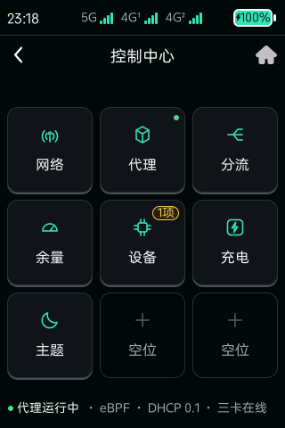
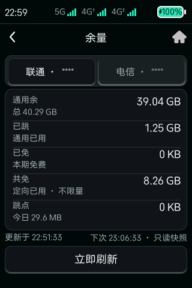
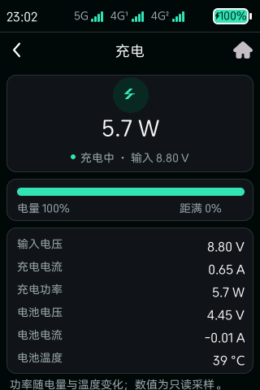
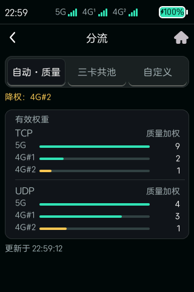
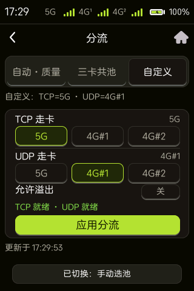
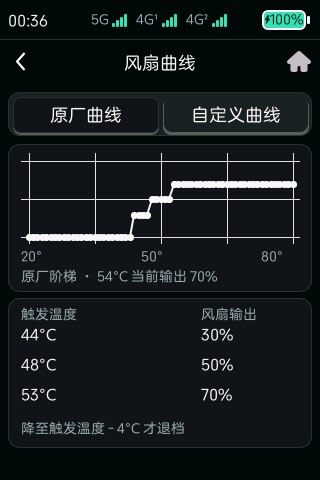
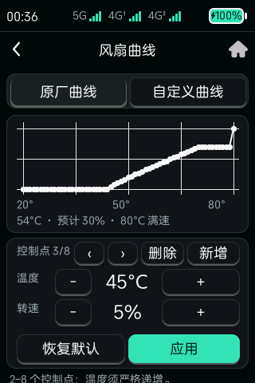

# TopFlow Toolkit — `feat/touchui-singbox-wanbal`

## 出处（原作者）

本仓库是 **[@imshuhao](https://github.com/imshuhao)** 的  
**[`imshuhao/topflow-toolkit`](https://github.com/imshuhao/topflow-toolkit)** 的 fork（MIT，`Copyright (c) 2026 imshuhao contributors`，见 [`LICENSE`](LICENSE)）。

- **原作完整说明、截图、Mihomo/LuCI/netns 安装：** 请先看上游  
  [main README](https://github.com/imshuhao/topflow-toolkit/blob/main/README.md)  
- **本分支额外致谢与第三方清单：** [`NOTICE.md`](NOTICE.md)

本分支只额外记录 **B20 现场自研改动**；未改动的上游模块版权与行为仍归原作。

---

> 分支主题：UTC 墙钟、Sing-box、触屏控制中心（OpenDesign 原型还原）、分流触控、无线 ADB、WebSSH、弱网黑匣子、OTA 冻结、聚合切回恢复等。

<p align="center">
  
  
  
  
  <a href="LICENSE"></a>
</p>

<p align="center">
  
</p>

## 适用范围（先读这段）

| | |
| --- | --- |
| **设备** | ZTE TopFlow MU5252（AArch64 / musl，原厂 LVGL 触屏） |
| **固件** | `BD_ENCNMU5252V1.0.0B20` |
| **不适用** | B22 及以后固件、其他型号、通用 OpenWrt 设备 |

这不是通用 OpenWrt 软件包：脚本依赖原厂 `zwrt-datad` 控制接口、非 PIE 固定地址的触屏 UI 进程、
厂商 mwan3 调优与蜂窝接口命名。换固件等于换一套 ABI，详见 [`docs/COMPATIBILITY.md`](docs/COMPATIBILITY.md)。

上游 `main` 已转向 **B22**（`firmware/b22/`、`luci-admin/`）。本分支固定在 B20，
`firmware/` 只作只读对照，**不跟随**上游固件线。

## 本分支改了什么（总览）

| 主题 | 一句话 |
| --- | --- |
| [墙钟与时区](#1-utc-墙钟--utc8-显示) | 系统时钟必须是真实 UTC；北京时间只用 `CST-8` 显示 |
| [Sing-box](#2-sing-box-宿主栈) | Clash→sing-box 转换、eBPF/`socket_assign`、零直连档、部署与自愈脚本 |
| [触屏控制中心](#3-触屏控制中心) | OpenDesign 原型整页还原（九宫格 + 共用状态栏 + 日夜令牌）、余量 / 充电页、设备四 tab、风扇曲线页 |
| [分流](#4-分流质量感知三卡选卡) | 自动·质量 / 三卡共池 / 自定义选池；弱网可溢出，不做协议硬绑死 |
| [无线 ADB](#5-无线-adb-wrapper-v5) | TCP `15555` + USB 三合一；**永不隐藏 functionfs** |
| [WebSSH](#6-webssh-局域网终端) | `8899` + 内置 sshd `22622`；B20 ubus/三卡补丁 |
| [弱网黑匣子](#7-弱网黑匣子) | 设备自记 JSONL，手机经 WebSSH 出报告 |
| [OTA 冻结](#8-ota-冻结) | hosts + iptables 双保险，挡官方强推 |
| [mwan3 恢复](#9-聚合切回恢复) | `recover.sh` + cron：切回普通模式后把调优/分流拉回 |

**明确未改上游逻辑：** `mihomo-netns`、`mihomo-manager`、`luci-admin`、`web-full-menu`、
`vendor-control`、`zwrt-datad-tools`、`firmware/` —— 介绍与安装以上游为准。  
`mwan3-tuning/` 在上游基础上**追加**了 `recover.sh` / `install-mode-guard.sh`。

---

## 触屏页面一览

按 OpenDesign 原型还原的实机画面（320×480，脱敏后只读抓帧）。数值是抓取瞬间的状态，
不是默认值；运营商号码后四位已遮挡成 `****`。更全的截图见 [`docs/SCREENSHOTS.md`](docs/SCREENSHOTS.md)。

| 页面 | 画面 |
| --- | --- |
| **九宫格首页**<br>网络 / 代理 / 分流 · 余量 / 设备 / 充电 · 主题 / 两个空位；代理格右上角是运行状态圆点，设备格徽标汇总未读短信、流量限额与温控异常。底部一行是代理状态 + 模式 + 在线卡数。 |  |
| **余量**（[协议出处见下](#余量查询出处)）<br>联通 / 电信两个 tab 共用一套五行卡：**通用余 / 已跳 / 已免 / 共免 / 跳点**，副行给总量、通用已用、本期免费、定向剩余与今日跳点。只读快照，底部标「更新于 / 下次」，「立即刷新」现采一次。 |  |
| **充电**<br>顶部大字是充电功率（`W`），状态行给「充电中 · 输入 x.xx V」；中间电量条 + 距满百分比；下方六行明细（输入电压 / 充电电流 / 充电功率 / 电池电压 / 电池电流 / 电池温度）。未插电时功率归零、前三行显 `--`。 |  |
| **分流 · 自动·质量**<br>三段预设 + TCP / UDP 有效权重条。质量降权时顶部用警告色点名被降权的卡（如图中的 `4G#2`），权重按实测延迟/丢包动态算。 |  |
| **分流 · 自定义**<br>TCP / UDP 各三个卡位 chip 手动选池 + 「允许溢出」开关，底部「应用分流」才下发；未应用前只改草稿。该档关闭质量降权与软偏置，卡位按你选的走。 |  |
| **风扇曲线 · 原厂**<br>只读阶梯表：44 / 48 / 53 °C 对应 30% / 50% / 70%，降到「触发温度 − 4 °C」才退档（滞回），80 °C 满速保护与模式无关。 |  |
| **风扇曲线 · 自定义**<br>可编辑 2–8 个控制点，温度严格递增、转速非递减；「新增 / 删除」调点数，「恢复默认」只重置草稿，「应用」前显示当前温度预计输出。 |  |

设备页「散热」tab（风扇四键 + 液冷三档 + 曲线入口）见
[`33-device-cool.png`](docs/screenshots/touchscreen/33-device-cool.png)，
应用曲线的二次确认见 [`33-cooling-confirm.png`](docs/screenshots/touchscreen/33-cooling-confirm.png)。

### 余量查询出处

联通 / 电信的**查询与授信协议**参考开源项目（触屏五行卡与跳点差分是本分支自研展示层）：

| 用途 | 上游 |
| --- | --- |
| 联通短信登录 / `token_online`、流量包查询 | [`ChinaTelecomOperators/ChinaUnicom`](https://github.com/ChinaTelecomOperators/ChinaUnicom)（GPL-3.0） |
| 电信登录与余量查询 | [`ChinaTelecomOperators/ChinaTelecom`](https://github.com/ChinaTelecomOperators/ChinaTelecom)（GPL-3.0） |
| 电信 DeviceId 短信授权（解「设备未信任」） | [`margrop/telecom-phone-device-id-tools`](https://github.com/margrop/telecom-phone-device-id-tools)（MIT） |

完整第三方表见 [`NOTICE.md`](NOTICE.md#余量查询协议参考必须标明)。本公开分支**不含**采集脚本与账号凭证。

---

## 1. UTC 墙钟 / UTC+8 显示

B20 原厂 NTP/NITZ 路径会把「本地 UTC+8」写进 Unix 墙钟 → TLS/代理集体失败。  
显示用 `TZ=CST-8`，墙钟必须是真实 UTC epoch。纪要：[`docs/TIMEZONE-FIX-2026-09-08.md`](docs/TIMEZONE-FIX-2026-09-08.md)。

| 层 | 落点 |
| --- | --- |
| UTC 兼容补丁（bind-mount，不分发原厂二进制） | [`timekeeper/`](timekeeper/) |
| HTTP Date 校时守卫 | [`timekeeper/fix-time-http.sh`](timekeeper/fix-time-http.sh) |
| 触屏注入 `TZ=CST-8` | [`touchscreen-control-center/start.sh`](touchscreen-control-center/start.sh) |

---

## 2. Sing-box 宿主栈

从 Clash Meta 生成 sing-box 配置、部署、看门狗、DHCP 守卫、eBPF 探测/回滚、三卡 `tf-sbwan` 选卡。

| 路径 | 作用 |
| --- | --- |
| [`singbox/convert.py`](singbox/convert.py) | Clash → sing-box（含 all-proxy / eBPF profile） |
| [`singbox/sing-box.sh`](singbox/sing-box.sh) | 启停 / switchover / rollback |
| [`singbox/singbox-wan-balance.sh`](singbox/singbox-wan-balance.sh) | 三卡 jhash + 质量降权 + 软偏置 |
| [`singbox/deploy.sh`](singbox/deploy.sh) | 相位备份 → check → 原子落盘 |
| [`singbox-manager/`](singbox-manager/) | Web/触屏管理入口与 `wan-mode-*` |

面板惯例：**不设** `clash_api.secret`（空字符串）。  
`NAS_DDNS_SUFFIX` 在公开分支已换成 `example.invalid`，请按自家 DDNS 改。  
**不提交** `singbox/generated/`、订阅、UUID。

相关公开纪要：[`docs/SINGBOX-MIGRATION-PLAN-2026-10-27.md`](docs/SINGBOX-MIGRATION-PLAN-2026-10-27.md)、[`docs/WAN-BALANCE-EBPF-COMPAT-2026-10-31.md`](docs/WAN-BALANCE-EBPF-COMPAT-2026-10-31.md)、[`docs/IPV6-DUALSTACK-FIX-2026-10-31.md`](docs/IPV6-DUALSTACK-FIX-2026-10-31.md)、[`docs/EBPF-MIGRATION-ROLLBACK-2026-10-31.md`](docs/EBPF-MIGRATION-ROLLBACK-2026-10-31.md)。

---

## 3. 触屏控制中心

原厂屏幕是 320×480 竖屏叠层触屏，界面跑在厂商的 `zte_topsw_devui`（LVGL，非 PIE、固定地址）里。
本组件用 `LD_PRELOAD` 往这个进程**追加**一层界面：**不替换原厂程序、不重打包厂商二进制、
不改分区、不写 boot/system/MTD**。

入口仍是原厂主页右下角那颗悬浮的「控制中心」按钮 —— 不是原型那种全屏启动页；
点开后才进入本组件，原厂页面照旧可用。

数据与写的边界：

- **读**：所有页面只读本机 `zwrt-datad` 的 `GET /state`（单个 64 KiB 缓冲），UI 线程不 `fopen` 设备文件。
- **写**：启停、风扇、Wi-Fi、分流等统一 `POST /control`，只发固定 action 与受约束参数；
  UI 不拼 shell、不直写 sysfs，参数在 UI 线程夹到合法区间后由 worker 线程下发。
- **失败**：只回显「设备控制接口执行失败」，不静默重试、不猜测上一次状态。

### 3.1 入口与菜单

```text
控制中心（3×3 九宫格）
├── 网络     三卡信号、QCI、AMBR 与实时速率
├── 代理     Sing-box 服务、数据面、流量与启停/重启 + 引擎切换
├── 分流     自动·质量 / 三卡共池 / 自定义选池
├── 余量     联通 / 电信五行余量与跳点（只读快照）
├── 设备     系统 · 流量 · 散热 · 无线 · 一键诊断
├── 充电     充电功率、电量条、六行明细
├── 主题     日 / 夜即时切换，落 /data/touchscreen-control-center/theme
└── 空位×2   虚线占位，不可点
```

「设备」格右上角带一个告警徽标（未读短信、流量限额、温控异常等汇总），
「代理」格右上角是运行状态圆点，不用点进去就能看出有没有事。
底部一行汇总代理状态、数据面模式、DHCP 与在线卡数。

实机画面见上面的 [触屏页面一览](#触屏页面一览)。

### 3.2 设计基线：OpenDesign 原型

界面按一份 320×480 的原型稿还原：**九宫格首页 + 共用状态栏 + 各子页卡片布局**，
原有功能（启停 / 重启 / 核心切换 / 分流预设 / 风扇 / Wi-Fi 功率…）在改版中一律保留，
不做「看着好看但按钮变少」的减法。落地情况逐项见 [3.3](#33-从原型到设备的落地状态)。

原型源文件在工作仓库的 `docs/design/touchui-prototype-2026-11-07/`
（`index.html` 单文件原型 + `colors.md` 色板表；另有冷却曲线的日夜两张对照图）。
本公开分支**不附带**该 HTML —— 它是设计工具的导出快照，含大量与实现无关的噪声，
且随设计工具改版会整文件重排，不便于按 diff 审阅。因此下面把可复用的**版面常量与色值**
直接抄录在此，移植时无需先拿到原型文件。

**几何**

| 层 | 位置 | 内容 |
| --- | --- | --- |
| 共用状态栏 | `y = 0..40`（40 px） | 时钟 / 三卡信号条 / 电池 |
| 页面 root | `320 × 440 @ y = 40` | 页头（返回 · 标题 · 主页）+ 内容 + 底栏或 toast |

- 页头高 44，内容区从 `y = 52` 起，宽 `304`（左右各 8）。
- 首页九宫格：格 **96×96**，pitch **104**，左边距 8；九格顺序固定，空位画虚线、不可点。

| 格 | 入口 | 内容 |
| --- | --- | --- |
| 1 | 网络 | 三卡总览、总速率、实时趋势 |
| 2 | 代理 | 运行状态圆点 + 核心/内存/数据面/DHCP + 流量 + 启停/重启 + 引擎切换 |
| 3 | 分流 | 三段预设 + TCP/UDP 有效权重（或自定义选池草稿） |
| 4 | 余量 | 联通/电信余量与跳点（只读快照） |
| 5 | 设备 | 四个 tab，见 [3.4](#34-设备页四个-tab) |
| 6 | 充电 | 充电功率、电量条、明细 |
| 7 | 主题 | 日/夜切换，落 `/data/touchscreen-control-center/theme` |
| 8–9 | 空位 | 虚线占位 |

**日夜令牌**（原型写在 `.screen` 作用域，切换只换变量、不动结构；落到设备时同一组值
写入 `/data/touchscreen-control-center/` 的配色配置）

| 角色 | 令牌 | 夜间 | 日间 |
| --- | --- | --- | --- |
| 背景 | `--bg` | `#07090A` | `#E9EEF0` |
| 卡片 | `--card` | `#12171A` | `#F7FAFA` |
| 强调 | `--accent` | `#35E0B0` | `#0B6E63` |
| 正文 | `--text` | `#F2F6F5` | `#0C1416` |
| 次要文字 | `--muted` | `#9BA9AA` | `#4E5F62` |
| 正常 / 警告 / 错误 | `--ok` / `--warn` / `--danger` | `#4ADE80` / `#F5C451` / `#FF7B72` | `#0B6B45` / `#7A4F00` / `#B3261E` |
| 强调上的文字 | `--accent-ink` | `#06201A` | `#F7FAFA` |
| 次级卡片 / 边框 / 进度轨 | `--card-2` / `--border` / `--track` | `#1A2124` / `#293336` / `#334044` | `#DDE5E6` / `#C6D2D3` / `#C6D2D3` |

配色约束（不遵守就会花）：

- 强调色只用于「可操作 / 生效中 / 充电中」；运行正常用正常色，弱信号用警告色，
  停止或失败用错误色 —— 同一屏不要让两种以上状态色抢注意力。
- 状态色不做大面积实底；需要底色时用对应的 `*-soft`，文字仍用状态色。
- 卡片与背景靠 1 px 边框 + 明度差分层，**不用**毛玻璃、模糊叠层、渐变。
- 禁用格用次级卡片底色 + 虚线边框；空位用透明底 + 虚线边框，两者都不可点。
- 两套主题的正文/次要文字均按 WCAG AA（≥ 4.5:1）校对；夜间正文与强调色在卡片上达 AAA。

**设备侧三条硬约束**（设计稿是 HTML，直接照搬会翻车）：

1. 设备 LVGL **没有 SVG，也没有符号字体** → 图标是预先栅格化好的 24×24 alpha 蒙版（16 级灰度），
   不是运行时矢量。新增图标按「原图 240×240 光栅化 → 面积平均降到 24×24 → 量化成 hex 蒙版」走，
   不要手搓点阵；手搓出来的线稿在 320 宽屏上会被认成别的形状。
2. 状态栏电池是**整颗位图**（外壳 + 凸起 + 填充 + 闪电一次合成，壳内直接画百分比），
   不是几个 LVGL 面板拼出来的 —— 12 px 高的组合面板在实机上糊。
3. 所有对象只在原厂 UI 线程创建、更新、延迟删除；网络、代理、设备各页**互斥加载**，
   避免耗尽原厂 LVGL 对象池；切页与锁屏要清空对象指针、页面状态和刷新 generation，
   否则会访问已释放对象。

### 3.3 从原型到设备的落地状态

原型是设计基线，代码是渐进落地的。当前除「入口」是有意偏离外，首页、共用状态栏、
日夜主题与各子页均已按原型落地：

| 项 | 原型 | 本分支代码 |
| --- | --- | --- |
| 入口 | 全屏启动页 | **保留**原厂右下角「控制中心」按钮（有意偏离） |
| 首页 | 3×3 九宫格 + 底栏状态行 | ✅ 已实现（详见 [3.1](#31-入口与菜单)） |
| 共用状态栏 | 时钟 / 三卡信号 / 电池 | ✅ 已接入（40 px，见 [3.2](#32-设计基线opendesign-原型)） |
| 日夜主题 | 「主题」格即时切换 | ✅ 日 / 夜双色板，即时重建并持久化 |
| 设备四 tab | ✅ | ✅ 已实现 |
| 系统 tab 字段 | 内核 / 版本 / 负载 / 内存 / 存储 / 电池 | ✅ 九行全有（内核、发行版、运行时间、负载 · CPU、内存、存储、电量、电池温度、电池电压） |
| 风扇曲线二级页 | ✅ | ✅ 已实现 |
| 分流 | 自动·质量 / 三卡共池 / 自定义 | ✅ 三段都有；自定义的**后端**见 §4 的说明 |
| 余量页 | ✅ | ✅ 已实现（联通 / 电信五行卡 + 手动刷新，数据来自 `/data/local/balance/status.json`） |
| 充电页 | ✅ | ✅ 已实现（功率 / 电量条 / 六行明细） |

**余量页**只读 `/data/local/balance/status.json`，五行口径固定为
**通用余 / 已跳 / 已免 / 共免 / 跳点**，副行补充总量、通用已用、
本期免费、定向剩余与今日跳点。两个运营商 tab 共用一套控件，切 tab 只换数据；
底部标注「更新于 / 下次」并声明是**只读快照**。
「立即刷新」会调 `balance-watch.sh once` 现采一次（固定路径、不经 shell、凭证不上 argv），
采完再回读快照。
运营商侧查询/授信协议对齐
[`ChinaUnicom`](https://github.com/ChinaTelecomOperators/ChinaUnicom) /
[`ChinaTelecom`](https://github.com/ChinaTelecomOperators/ChinaTelecom) /
[`telecom-phone-device-id-tools`](https://github.com/margrop/telecom-phone-device-id-tools)
（详见 [余量查询出处](#余量查询出处) 与 [`NOTICE.md`](NOTICE.md)）；
本公开分支**不含**采集脚本与账号凭证，只有读取与展示逻辑。

**充电页**按 `zwrt-datad` 的 `battery` 段显示充电功率（`charger_uv × charger_ua`）、
电量进度条与六行明细；未插电时功率归零、输入侧三行显示 `--`，不会拿残留采样算出假功率。

上面的 [触屏页面一览](#触屏页面一览) 有这两页的实机画面。

### 3.4 设备页：四个 tab

页顶是状态摘要 + 「一键诊断」，下面四个 tab 共用同一个内容容器，切 tab 只重建容器、不重建页面。

| tab | 内容 | 可操作性 |
| --- | --- | --- |
| **系统** | 内核、系统（发行版）、运行时间、负载 · CPU、内存、存储；电池电量、电池温度、电池电压 | 全只读 |
| **流量** | 实时（↓ / ↑）一张卡，今日 / 本月 / 累计 三张卡 | 全只读 |
| **散热** | 风扇四键 + 液冷三档 + 「编辑曲线」入口 | 见 [3.5](#35-风扇曲线二级页) |
| **无线** | 2.4G / 5G 分段；日常功率、功率上限 | 还原 / 应用 |

- **系统**只读，且整页不带按钮 —— 所以滚动不会和点按抢手势，也不会因为误触改到东西。
  两组只读卡片：系统（内核 / 发行版 / 运行时间 / 负载 · CPU / 内存 / 存储）、
  电池（电量、电池温度、电池电压）。内核与发行版由 worker 读 `/proc` 与
  `openwrt_release` 缓存后填，不是每帧现读。
  读取失败时统一显示 `--`，绝不沿用上一次的数字 —— 否则会出现「拔卡后仍显示在线」这种假状态。
- **流量**是设备侧的会话 / 日 / 月 / 累计计数，不是运营商账单；运营商侧用量走「余量」页
  （见 [3.3](#33-从原型到设备的落地状态)）。
  实时列单独标「当前会话」，切 tab 不会清零累计值。
- **散热**：风扇四键 **原厂 / 自定义 / 常开 / 常闭**
  - 原厂 = 交回内核温控（44 / 48 / 53 °C 三档）；
  - 自定义 = 套用已保存的自定义曲线（没有可用曲线就先写入默认 8 点曲线）；
  - 常开 = 风扇常驻 50%，**80 °C 满速保护仍然生效**；
  - 常闭 = 写入零转速曲线 + `enabled=false`，温控不再自动拉起。

  液冷三档 **自动 / 低档 / 高档**，自动 = 交回原厂按需启动。
  每一次切换都先弹二次确认，确认后才下发 —— 这四个键里有关风扇的，误触代价很实在。
- **无线**：2.4G / 5G 各自独立草稿，互不串味；日常功率 10%–100%（步进 10%），
  功率上限 1–30 dBm（步进 1 dBm）。「还原」只把上限回填成出厂值，不动日常功率；
  「应用」二次确认并明确提示 **Wi-Fi 会重载，已连接设备将短暂断线**。
  这里只改功率参数，不碰 SSID / 密码 / 信道。

**一键诊断**固定 6 行：数据服务、蜂窝链路、地址与 DNS、三路路径、Sing-box、温控保护。
顶部汇总是「可解释」的：未读短信、流量达限额这类没有明细行的问题会被点名计入，
不会出现「6 行全绿却显示 N 项需要关注」。

### 3.5 风扇曲线二级页

从散热卡的「编辑曲线」进入，页头可返回设备页。顶部是横轴 `20° / 50° / 80°` 的折线图，
中间一行汇总当前温度下的预计输出与满速点，下方按模式切换内容区。

**原厂曲线（只读）** —— 阶梯表 + 当前温度的实际输出：

| 触发温度 | 风扇输出（PWM） | 约合 |
| --- | --- | --- |
| 44 °C | 76 | 30% |
| 48 °C | 128 | 50% |
| 53 °C | 179 | 70% |

- 这是「交还原厂」时实际写回的曲线（含 20 °C / 0% 起点与 80 °C / 满速收尾共 5 点）。
  设计原型里画的 20% / 40% / 70% 只是示意值，落地以这张表为准。
- 必须降到「触发温度 − 4 °C」才退档（滞回）；否则温度在阈值附近抖一下，
  风扇就会来回启停，听感很差。
- 80 °C 是满速保护点（PWM 255），跟当前处在哪种模式无关 —— 自定义曲线也绕不过它。

**自定义曲线（可编辑）**：

- **2–8 个控制点**。默认给一条 8 点低转速平滑曲线：40 °C 起步，44–50 °C 每 1 °C 一点，
  70 °C 收在 70%，避免低负载时风扇忽然拉起来。
- **温度严格递增**：每个点被夹在「前一点 +1 °C」与「后一点 −1 °C」之间，
  末点不超过满速温度 −1 °C。所以拖滑块时不会造出交叉点。
- **转速非递减**：每个点夹在前后点的转速之间，步进 5%。
- 「新增」在当前点与下一点之间插中点（要求两点间距 ≥ 2 °C），末点之后按 +5 °C 追加；
  「删除」至少保留 2 个点。
- 「恢复默认」只重置草稿、不落盘；「应用」先弹确认并显示「当前温度预计输出 x%」，
  如果当前不在自定义模式，会**连带切换到自定义模式**。
- 曲线用线性插值；温度到达满速点后直接输出 100%。

**下发方式（概念层）** —— 全部走本机 datad 的 `POST /control`，只发固定 action：

| action | 参数 |
| --- | --- |
| `cooling.fan.set_curve` | `points[]`，每点 `{temperature, pwm}`，2–8 点 |
| `cooling.fan.set_mode` | `automatic` / `custom` / `always_on` |
| `cooling.fan.set_enabled` | `true` / `false`（常闭时用） |
| `cooling.liquid.set_mode` | `automatic` / `low` / `high` |

曲线在 UI 线程先夹到合法区间并做快照，再交给 worker 逐条发送；worker 不无锁读 UI 状态。
「自定义」与「常闭」在 datad 侧是同一套曲线机制，区别只在曲线内容和 `enabled`，
所以恢复时要显式写回曲线，光切模式是不够的。

### 3.6 编译 / 部署 / 验证

```sh
# 常规：自备 AArch64 musl 交叉工具链
CC=aarch64-linux-musl-gcc ./build.sh     # 产出 touchui-hook.so

# 没有 musl-gcc 时用 Zig，等价命令行
zig cc -target aarch64-linux-musl -shared -fPIC -Os -Wall -Wextra -Werror \
  -Wl,-soname,touchui-hook.so -o touchui-hook.so touchui-hook.c -ldl -pthread
```

```sh
./install.sh        # 核对原厂 UI 哈希 → 部署注入库/监督脚本/init → 写 rc.local 兜底块
```

- **换 `.so` 必须 stop + start**，不能只覆盖文件：原厂 UI 已经把旧库映射进进程，
  `start.sh` 会先结束 `zte_topsw_devui`，等 QPIC 显示管道释放后再拉起新进程
  （`start.sh` 内置启动互斥，boot 与人工启动并发只会留一个）。
- **部署后核对 maps**：`grep -c touchui-hook.so /proc/$(pidof zte_topsw_devui)/maps`
  应能看到多条映射；为 0 说明注入没生效，先看 `/tmp/touchscreen-control-center-ui.log`
  与 `/tmp/touchui-create.log`。日志写在 tmpfs 且带容量守卫，不会无限涨。
- 服务状态：`/etc/init.d/touchscreen-control-center status`。
- 整页自检：`touch /tmp/touchui-selftest`，通常约 20 秒走完全部页面
  （锁屏或 LCD 关闭时原厂会降低 LVGL timer 频率，最长可能接近 60 秒），
  完成标记写 `/tmp/touchui-create.log`。
- 回滚：`./uninstall.sh` 移除服务、启动块与数据目录并恢复原厂 UI；
  它不会停 sing-box、不改网络配置、不删 `zwrt-datad`。

**截图**：设备没有 Android `screencap`，也没有传统 framebuffer。`capture-screen.sh` 通过 root ADB
只读抓 QPIC DRM 当前帧，把 320×480 RGB565 转成 PNG；抓帧前后核对单一 UI 进程、DRM 格式、
双缓冲映射与完整帧长度，不写显存、不改屏幕状态。实机画面见 [`docs/SCREENSHOTS.md`](docs/SCREENSHOTS.md)。

**兼容性**：原厂 `zte_topsw_devui` 是固定地址、非 PIE 程序，导航按钮直接引用该进程内已加载的对象，
所以安装器严格核对它的 SHA-256，不匹配就停下。**不要**为了装上而绕过这道检查；
换固件要重新审计 LVGL ABI、对象地址、生命周期与恢复路径。

---

## 4. 分流：质量感知三卡选卡

宿主出站 `SO_MARK 0x2024` 后 mwan3 会跳过这些包；`singbox-wan-balance.sh` 按权重把**代理出站**分到在线蜂窝卡。
三张卡在脚本里叫 `zte_mwan2` / `zte_mwan3` / `zte_mwan4`，对应界面上的 **5G / 4G#1 / 4G#2**。

| 预设 | 行为 |
| --- | --- |
| **自动·质量** | 共池 + 质量降权（mwan3 延迟/丢包，可选 5G 射频样本）+ TCP 偏 5G、UDP 偏 4G 的软偏置；弱网可溢出 |
| **三卡共池** | 强制共池；仍质量降权；无软偏置 |
| **自定义** | TCP / UDP 各钉一组卡位（至少各留一张）；**质量降权与软偏置均关闭**；`overflow` 决定所选卡全下线时的行为（见下） |

触屏「自定义」是**手动选池的草稿视图**：点分段只切视图并播种草稿，
「应用分流」才把池掩码下发（`wan-mode-set custom <tcp_list> <udp_list> <overflow>`）。
`game`（硬绑 TCP=5G、UDP=双 4G）仅 CLI 可用。

- **溢出关（`overflow=0`）**：某协议选中的卡全部离线时，该协议**直接丢包**（fail closed），
  不会偷偷漏到别的卡上。
- **溢出开（`overflow=1`）**：该协议退回三卡共池（spill），可用性优先于固定卡位。

> **前后端落地状态**：触屏有「自定义」入口，脚本侧 `preset-set custom …` 也已支持
> 手动池。但**公开支线的管理后端是否已放行 `custom` 需以设备上的脚本为准**——
> 若 `singbox-manager.sh` 的 `wan-mode-set` 仍只接受 `auto|shared|game`，
> 点「应用分流」会返回失败，此时请以 `sh singbox/singbox-wan-balance.sh preset-list`
> 与脚本本体为准，不要把这里当成已全栈上线。

```sh
sh /data/sing-box/singbox-wan-balance.sh preset-set auto
sh singbox/tests/test_wan_balance_render.sh
```

调参依据是 `weaknet` 报告的 mwan3track 延迟/丢包与质量档（见 §7），不要凭体感。

---

## 5. 无线 ADB（wrapper v5）

[`adb-wifi/`](adb-wifi/)：端口 **15555**，iptables 只放行 `lo`/`br-lan`。  
**永不重启 adbd、永不隐藏 `/dev/usb-ffs/adb`**。

- 端口由 wrapper 在 adbd 启动前用 `service.adb.tcp.port` 设置。本机没有 `/data/property/`，
  `persist.adb.tcp.port` 重启即丢，别用。
- 隐藏 functionfs 会让复合设备永远绑不上（USB ADB 与 RNDIS 一起消失）；这是踩过的坑，
  不是可选项。
- 通道只对 LAN 开放：`adb connect 192.168.0.1:15555`，Wi-Fi 与 USB RNDIS 都通。
- USB 排障与端口定性：[`docs/USB-ADB-DIAG-2026-10-30.md`](docs/USB-ADB-DIAG-2026-10-30.md)。

---

## 6. WebSSH（局域网终端）

[`webssh/`](webssh/)：浏览器终端 `http://192.168.0.1:8899/app` + 内置 sshd `192.168.0.1:22622`。

**出处：** [`o8oo8o/WebSSH`](https://github.com/o8oo8o/WebSSH) → [`kanoqwq/WebSSH-u60pro`](https://github.com/kanoqwq/WebSSH-u60pro)；本目录只放 B20 补丁与安装脚本，**不附带**完整源码树与 arm64 二进制（见 [`webssh/BUILD.md`](webssh/BUILD.md)、[`NOTICE.md`](NOTICE.md)）。

本机补丁要点：ubus `subid` 兼容、`GET /api/modems` 三卡、`start.sh` 强制 `-ConfigDir /data/webssh`。
细节与实测输出：[`docs/WEBSSH-DEPLOY-2026-10-27.md`](docs/WEBSSH-DEPLOY-2026-10-27.md)。

- 连接条目写 `192.168.0.1:22622`：内置 sshd 只绑 LAN 地址，`127.0.0.1` 会 refused；
  `15555` 是 adb，不是 SSH。
- 启动必须带 `-ConfigDir`：程序用当前工作目录定位配置，cwd 不对会退化成只读根目录下的
  隐藏目录，并静默绑到 `0.0.0.0`。

---

## 7. 弱网黑匣子

[`weaknet/`](weaknet/)：与现行分流同信号（mwan3track lat/loss + 质量档/权重）；手机 WebSSH → `weaknet-report.sh` / `--live`。

设备自记 JSONL（约 30 秒一行，保留 7 天），**不再自己 ping** —— 旧的自 ping 数字和 mwan3track
对不上，照着它调参只会越调越偏。现场排查：WebSSH 进去跑报告，`--live` 看当前，`--events` 看事件。

---

## 8. OTA 冻结

[`ota-block/`](ota-block/)：hosts + `TOPFLOW_OTA_BLOCK4/6` + rc.local 钩子，外加 30 秒 keeper 兜底。  
恢复官方升级：`ota-block.sh revert`（会一并清掉 hosts 托管块与 iptables 链）。

冻结的理由很简单：改机状态下的官方 OTA 会把 `/data` 之外的改动整片覆盖掉，
升上去之后代理、触屏、ADB 一起失效，且不一定能降回来。

---

## 9. 聚合切回恢复

[`mwan3-tuning/recover.sh`](mwan3-tuning/recover.sh) + [`install-mode-guard.sh`](mwan3-tuning/install-mode-guard.sh)：  
`SMULTIWAN`→`MULTIWAN` 后幂等重载调优与 wan-balance。

聚合模式下厂商 ICG 接管，调优脚本不生效；切回普通模式时只写了 uci 而没有重载 mwan3，
表现就是「聚合关了，但代理没恢复」。`recover.sh` 补的就是这一段（`--verify` 只读、
`--check` 仅不一致时动作、`SMULTIWAN` 下自退），另装 cron 每 2 分钟幂等检查。

---

## 本分支路径一览

| 路径 | 角色 |
| --- | --- |
| `timekeeper/` | UTC 墙钟 + HTTP Date 守卫 |
| `touchscreen-control-center/` | 触屏控制中心（九宫格首页 / 网络 / 代理 / 分流 / 余量 / 设备四 tab / 充电 / 主题 / 风扇曲线） |
| `singbox/`、`singbox-manager/` | 宿主栈与管理入口 |
| `adb-wifi/` | 无线 ADB wrapper v5 |
| `webssh/` | WebSSH 部署包装 + B20 补丁（第三方见 NOTICE） |
| `weaknet/` | 弱网自记录 |
| `ota-block/` | OTA / 上报域名冻结 |
| `mwan3-tuning/recover.sh` 等 | 聚合切回恢复 |
| `docs/*2026-*.md` | 公开技术纪要 |
| `docs/screenshots/` | 脱敏实机截图（号码/ICCID/IMEI/小区标识已永久遮挡） |
| [`NOTICE.md`](NOTICE.md) | 原作者与第三方出处 |

## 与上游的关系

本分支是 fork **增量**，不是重写：

- 未改模块（`mihomo-netns`、`mihomo-manager`、`luci-admin`、`web-full-menu`、`vendor-control`、
  `zwrt-datad-tools`、`firmware/`）的行为、安装步骤与兼容边界**以上游 README 为准**，
  这里不重复、也不改写。
- 本分支改动的模块都在上面的路径表里，各自目录下的 `README.md` 有更细的用法。
- 上游 `main` 面向 B22，本分支面向 B20。这是两条**并行**固件线：`timekeeper` 的补丁偏移与
  校验值完全不同，硬合会让时钟补丁失效。要跟进上游只能逐条挑单个提交，
  并确认它不绑固件版本。

## 公开仓不含什么（脱敏边界）

| 不含 | 原因 |
| --- | --- |
| 私人交接全文（现场事故流水、主机名、家庭域名） | 只保留可复用的技术结论，已抽象成 `docs/*2026-*.md` |
| 订阅链接、UUID、节点凭据、机场域名 | 属于账号资产，一律不带 |
| `singbox/generated/`（生成的 config 与 provider） | 由 `convert.py` 本地生成，含订阅派生数据 |
| 余量/授信的采集脚本、真实凭证与账号数据 | 只在设备本地；仓库只有 `status.json` 的读取与展示逻辑，`balance/` 采集端不在公开分支 |
| 设备侧二进制（`sing-box`、`webssh`、`touchui-hook.so`、原厂厂商库） | 不分发厂商或第三方二进制，请自行编译/下载 |

示例地址统一用出厂网关 `192.168.0.1`；DDNS 占位为 `example.invalid`；
截图是脱敏后的产物，仓库不含未遮挡原图。

## 建议验证

```sh
date -u
sh singbox/tests/test_wan_balance_render.sh
curl -s -o /dev/null -w '%{http_code}\n' http://192.168.0.1:8899/app/   # 若已部署 WebSSH → 200
sh /data/local/weaknet/weaknet-report.sh                                 # 若已部署
sh /data/local/mwan3-tuning/recover.sh --verify                          # 若已部署
/etc/init.d/touchscreen-control-center status                            # 若已装触屏组件
```

## 仓库链接与致谢

| | |
| --- | --- |
| **原作者 / 上游** | [@imshuhao](https://github.com/imshuhao) · [imshuhao/topflow-toolkit](https://github.com/imshuhao/topflow-toolkit) |
| 本 fork | [shizongrengkou/topflow-toolkit](https://github.com/shizongrengkou/topflow-toolkit) |
| PR | [#2](https://github.com/imshuhao/topflow-toolkit/pull/2) |
| **余量查询协议参考** | [ChinaUnicom](https://github.com/ChinaTelecomOperators/ChinaUnicom) · [ChinaTelecom](https://github.com/ChinaTelecomOperators/ChinaTelecom) · [telecom-phone-device-id-tools](https://github.com/margrop/telecom-phone-device-id-tools) |
| 出处清单 | [`NOTICE.md`](NOTICE.md) |

本分支的所有改动都建立在上游作者的原始工具包之上；遇到本分支没有覆盖的模块（Mihomo netns、
LuCI、Web Full Menu 等），请回到上游 README 并在上游 issue 区反馈。
再分发时请同时保留 [`LICENSE`](LICENSE)、[`NOTICE.md`](NOTICE.md) 与各第三方版权声明。
