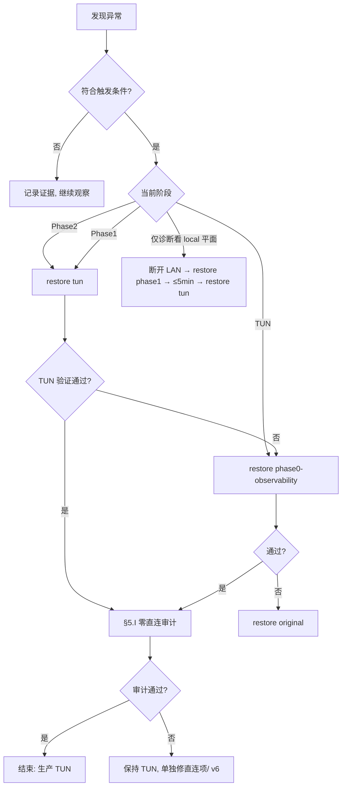

# eBPF 迁移回滚手册（B20 / 2026-10-31）

> **⚠️ 先记住这两条（免流/零直连前提）：**
> 1. **Phase1（eBPF local-only）不代理 LAN 客户端。** 它没有 TUN、没有 `shared`、
>    也没有 nft redirect —— LAN 流量是**直连**。免流场景下**直连 = 烧真实流量 = 失败**，
>    所以 Phase1 **不是可停留的回滚态**：最多是“LAN 客户端全部断开”的几分钟诊断窗口，
>    或者直接跳过。**生产回滚终点只有一个：TUN（`tun`）。**
> 2. 回滚只换捕获路径，**不改变配置里既有的直连项**（14 个 PT 域、DNS bootstrap/DoH、
>    ICMP 等）。回滚后仍须过 §5.I 的零直连审计，否则不能宣称“免流已恢复”。
>
> 适用：`/data/sing-box` 从 TUN 全代理（`tun-allproxy`）迁移到 eBPF `local` + `shared`
> （Phase1 / Phase2）。设备 ZTE TopFlow MU5252 B20，kernel `5.15.194-perf`，
> sing-box `1.14.4-reF1nd`（`with_ebpf`）。
>
> 配套脚本：`singbox/backup-config.sh`（设备侧 `/data/sing-box/backup-config.sh`）。
> 迁移路线见 `docs/EBPF-MIGRATION-RUNBOOK-2026-10-31.md`；eBPF 细节见
> `docs/TELEGRAM-E58695-SINGBOX-DIGEST-2026-10-30.md` §3；故障取证见
> 私人交接文档（未公开发布） §31.1 / §31.4。

---

## 0. 四条铁律（先读，能省一次整网断网）

1. **回滚 = 换 `config.json` + `sing-box.sh restart`，不是 `sing-box.sh rollback`。**
   `sing-box.sh rollback`（WebUI「切回 mihomo」、触屏「回滚态」）会把 DHCP 网关/DNS
   改成 `192.168.0.254` 并启动 mihomo netns，是**换引擎**，不是换配置；用错会改 DHCP、
   整网换网关，且 `start_core` 在 mihomo 运行时拒绝启动。**迁移回滚永远不要按它。**
2. **Phase1 不代理 LAN，且免流下不可接受。** Phase1 只有 eBPF `local`（本机 cgroup），
   没有 TUN、没有 `shared`、**也没有 nft redirect**。LAN 客户端在 Phase1 是**直连**：
   免流场景里这等于直接消耗 SIM 流量。工单里“Phase1 LAN 仍走 nft redirect”的说法不成立：
   sing-box 的透明 redirect 需要 `type: redirect` 入站，而生成器从未产出该入站，把 LAN TCP
   redirect 到 `mixed:7890` 会因为协议不匹配直接失败。因此：
   - Phase2 故障 → **直接回 TUN**（唯一可接受的生产态）；
   - Phase1 只允许在 **LAN 客户端全部断开**时做 <5 分钟诊断，或直接跳过；
   - 绝不允许“先回 Phase1 让大家上网”作为降级方案（那是烧流量）。
3. **30 秒预算是硬指标。** `backup-config.sh restore` 会打印 `elapsed=Ns`。
   一次回滚超过 30s 或 API 没起来，说明**目标档本身不可用**，立即沿链再降一档
   （Phase2 → **TUN** → Phase0 → Original；Phase1 只作断开 LAN 的诊断档）。
   不要原地重试。
4. **零直连验收。** 免流要求：除 LAN/私有地址与管理面外，**TCP/UDP、IPv4/IPv6、
   国内/国外都必须走代理，不允许任何直连出口**。回滚成功 ≠ 免流恢复；
   必须同时通过 §5.I 的直连审计（14 个 PT 域、DNS bootstrap/DoH、ICMP 等既有直连项
   在 TUN 档同样存在，回滚不会修好它们）。

---

## 1. 阶段、备份与故障域对照

| 阶段 | 配置档 | 入站/捕获 | 设备本机 | LAN 客户端 | 失败时降到 |
|---|---|---|---|---|---|
| `original` | 迁移前 TUN（无 observability） | `tun` + auto_route | 代理 | 代理 | —（最后防线） |
| `phase0-observability` | TUN + `experimental.observability` | 同上 | 代理 | 代理 | `original` |
| `phase1-ebpf-local` | eBPF `local` cgroup | 无 TUN，无 shared | **代理** | **直连（烧流量，生产不可接受）** | `tun` |
| `phase2-ebpf-shared` | eBPF `local` + `shared.packet_rewrite`（br-lan） | TC ingress/egress | 代理 | 代理（**§31.1 卡顿风险**） | **`tun`**（唯一生产态）；Phase1 仅作断开 LAN 的诊断 |
| `tun` | `tun-allproxy`（**现网**） | `sbtun0` + auto_route/auto_redirect | 代理 | 代理 | `phase0` |
| `pre-restore` | `restore` 自动写的前一状态 | — | — | — | 用于“撤销刚做的回滚” |

> 允许直连的**只有**：LAN/私有地址（`192.168.0.0/16`、`10/8`、`172.16/12`、ULA、
> link-local、multicast）和设备管理面（`192.168.0.1` 的 80/8899/9999/22622、DHCP、DNS 到
> dnsmasq）。**其余任何公网直连都算免流失败**；DNS bootstrap（`223.5.5.5`）是目前配置里
> 唯一“可能不得不直连”的引导流量，严格零直连下也属**待拍板例外**，见 §5.I #4。

现网基线（2026-10-30 起）：

| 项 | 值 |
|---|---|
| 配置 | `tun-allproxy`，70567 B，md5 `d0d9e63c78e2497b0b0cc86ba495419d` |
| 内核 | pid 文件 `/data/sing-box/state/sing-box.pid`，单实例 |
| API | `http://127.0.0.1:9999/version`，`secret=""`（§29） |
| TUN | `sbtun0`，`172.19.0.1/30`，mtu 1400 |
| DHCP | `3,192.168.0.1` + `6,192.168.0.1` |
| 三卡 | 9×8 MB 并发基线 ≈ 5G 44% / V3E1 23% / V3E2 34% |
| 已知阻塞 | IPv6/双栈 000（§31.4）：免流要求 v6 也走代理，**这是迁移/回滚都必须记住的验收阻塞项**；TUN 与 eBPF 同样存在，回滚不修复，见 §5.I |

---

## 2. 回滚触发条件

任一条件成立即可执行对应回滚；**触发不需要再请示**（用户已授权“任何不满意都可回滚”）。
每条都给了可复现的判据，避免“感觉卡”。

### T1 · Phase1 失败（本机代理不通）

在设备上连续两次（间隔 10s）执行：

```sh
curl -s -o /dev/null -w '%{http_code}\n' -m 8 \
  -x http://127.0.0.1:7890 https://www.gstatic.com/generate_204
```

- 返回不是 `204` → **回 TUN**（不是回 Phase0）。
- 或 `sh /data/sing-box/sing-box.sh status` 60s 后仍 `core: stopped` / `api: down`。
- 或 eBPF 配置下 `ip link show sbtun0` 仍存在（双捕获，见 §7 陷阱 7）。
- 或 `state/sing-box.log` 出现 `ebpf` attach 失败、panic、`operation not permitted`。

> Phase1 的 LAN 判据不是“能上网”，而是“**LAN 流量为零**”：免流下 LAN 直连就是故障。
> 只要还有客户端在线，Phase1 只能停留几分钟（或直接跳过）。

### T2 · Phase2 卡顿（§31.1 症状）

同时满足以下两条 → **立即回 TUN（跳过 Phase1）**：

1. LAN 客户端 TCP 能握手但数据不回：`curl` 返回 `000` / TLS 卡住；
   在 br-lan 抓包可见 **ClientHello 重传**、之后只有 **SYN-ACK 重传**。
2. 设备本机代理仍正常（T1 的 gstatic = 204），且 PC 走 `mixed:7890` 也正常
   （`curl -x http://192.168.0.1:7890 ...` = 204）——证明故障只在 shared 客户端路径。

辅助证据：PC 请求期间 `/observability/v1/connections/active` 连续为空
（`{"data":[],"total":0}`），`recent` 里也没有该连接。**仅“active 为空”不足以触发**，
必须同时有 LAN 卡顿；Phase1 下 LAN 本来就不进 sing-box。

> **免流约束**：不要用 Phase1 当“先让大家上网”的缓冲 —— 那是直连烧流量。
> 只有 TUN 备份缺失/损坏时，才临时 Phase1，并且**立刻断开全部 LAN 客户端**（≤5 分钟）。

### T3 · 三卡分流失效（只走 5G）

在 PC 上跑 9 路并发 8 MB 下载（或等价的 `curl` 循环），前后读设备三卡计数：

```sh
# 设备
awk '/rmnet|mwan|wwan/{print $1, $2, $10}' /proc/net/dev
```

- 单卡（通常 `rmnet_data0`）占比 > 90%，或另外两张卡增量 < 10%；
- 连续两次测试一致；
- `sh /data/sing-box/singbox-wan-balance.sh status` 显示 `source: fallback`
  （TUN 档应为 `source: rule`；eBPF 档应为 `source: ebpf` 且**自定义链是 no-op**，
  实际分流靠 mwan3 原生规则）。

→ **立即回 TUN**。Phase1 不是有效降级：它根本不接管 LAN，谈不上分流。

### T4 · observability 异常

```sh
curl -s http://127.0.0.1:9999/observability/v1/connections/active | head -c 300; echo
curl -s -o /dev/null -w '%{http_code}\n' http://127.0.0.1:9999/observability/v1/status
```

- `/status` 非 200，或 `/metrics` 5xx；
- 或 LAN 正在下载 > 1 MB，而 `active.total` 连续 60s 为 0（**仅在 Phase2/TUN 有意义**）；
- 或面板（`:9999/ui/`）有流量但 API 连接列表持续为空。

→ 回 **TUN**（Phase1 只能作断开 LAN 的诊断，不能当生产降级）；如果只是 API 异常而数据面正常，
可以先 `sing-box.sh restart` 一次，仍异常再回滚（不回滚不阻塞上网）。

### T5 · 用户手动回滚

任何不满意、任何“先回到能用的状态”，直接执行 §3 的对应命令。
**任何出现公网直连的降级也属于此列**（免流烧流量），无需再确认。

### T6 · 回滚自身超时

`backup-config.sh restore` 输出 `elapsed>30s` 或 `RESULT: FAIL` → 按它给出的
`next:` 再降一档。

### 不要触发的项（避免误回滚）

- **IPv6/双栈 000**：不是回滚触发条件 —— TUN 与 eBPF 同样失败，回滚不会修好。
  但它是**免流验收的阻塞项**（v6 也必须经代理），必须单独修：fake-ip v6 + 节点 v6 出口，
  并把 `.cn`/`geosite-cn` 从“返回真实 AAAA”的路径改走 fake-ip，见 §5.I。不要因为
  双栈 000 就停在 Phase2。
- 节点池抖动、单个节点超时、14 个 PT 域的直连（后者是**待修的直连项**，不是回滚理由）。
- 回滚不修复配置内的直连项：别把“回滚成功”当成“零直连通过”。
- **Phase1 下 LAN 直连不是“设计如此可接受”**：它本身就是必须离开该阶段的理由。

---

## 3. 分阶段回滚（带命令）

### 3.1 从 Phase2 回到 TUN（首选；唯一可接受的生产回滚）

**A. 脚本（推荐，带 md5 校验、自动安全备份、≤30s 计时）**

```sh
adb -s 192.168.0.1:15555 shell \
  'cd /data/sing-box && sh backup-config.sh restore tun'
```

**B. 工单原始命令（等价，无自动校验）**

```sh
adb shell 'cd /data/sing-box && \
  cp config.json config.json.failed-phase2 && \
  cp config.json.bak-tun config.json && \
  sh sing-box.sh restart'
```

验证（TUN）：

```sh
adb shell 'cd /data/sing-box && sh sing-box.sh status'
# 期望：tun: 36: sbtun0 ... mtu 1400 ... <UP,LOWER_UP>
#       core: running / api: <版本> / dhcp: 3,192.168.0.1 ...
adb shell 'sh /data/sing-box/singbox-wan-balance.sh status | sed -n "1,20p"'
# 期望：source: rule（不是 fallback/ebpf）
```

PC：`curl -4 https://www.baidu.com` = 200、`gstatic` = 204、管理面
`http://192.168.0.1/` 与 `:9999/ui/` = 200。

> **免流验收**：TUN 恢复≠免流恢复。必须继续做 §5.I 的零直连审计；
> 14 个 PT 域、DNS bootstrap/DoH、ICMP 等直连项在 TUN 档同样存在，回滚不会修好它们。

### 3.2 从 Phase2 回到 Phase1（仅限“LAN 全断开”的诊断窗口）

**只有在 TUN 备份缺失/损坏，或需要单独验证 local 平面时才用。**
Phase1 期间 LAN 是直连（烧流量），因此必须先断开所有 LAN 客户端，
窗口 ≤5 分钟，结束后立刻执行 3.1 回 TUN。

**A. 脚本**

```sh
adb -s 192.168.0.1:15555 shell \
  'cd /data/sing-box && sh backup-config.sh restore phase1-ebpf-local'
```

**B. 工单原始命令**

```sh
adb shell 'cd /data/sing-box && \
  cp config.json config.json.failed-phase2 && \
  cp config.json.bak-phase1-ebpf-local config.json && \
  sh sing-box.sh restart'
```

验证（Phase1）：

```sh
adb shell 'cd /data/sing-box && sh sing-box.sh status'
# 期望：core: running / api: <版本> / in: ebpf (local cgroup only)
#       tun: 为空（eBPF 模式没有 sbtun0，该行可能没有内容）
#       dhcp: 3,192.168.0.1 6,192.168.0.1
adb shell 'ip link show sbtun0'     # 期望：不存在
adb shell 'curl -s -o /dev/null -w "%{http_code}\n" -m 8 -x http://127.0.0.1:7890 https://www.gstatic.com/generate_204'  # 204
# LAN 侧：确认没有客户端在线，或 observability 里没有新的 LAN 连接
curl -s http://127.0.0.1:9999/observability/v1/connections/active | head -c 200
```

> 注：`config.json.bak-phase1-ebpf-local` 是 `backup-config.sh` 维护的稳定别名
> （硬链接到该阶段最新时间戳副本）。没有别名时用
> `ls config.json.bak-phase1-ebpf-local-*` 选最新，或直接用脚本 restore。

### 3.3 从 Phase1 回到 TUN（恢复 LAN 代理/免流）

```sh
adb -s 192.168.0.1:15555 shell \
  'cd /data/sing-box && sh backup-config.sh restore tun'
# 或工单原始命令：
adb shell 'cd /data/sing-box && \
  cp config.json config.json.failed-phase1 && \
  cp config.json.bak-tun config.json && \
  sh sing-box.sh restart'
```

验证同 3.1（`sbtun0` UP、`source: rule`、PC 200/204），随后过 §5.I 零直连审计。

### 3.4 从 Phase0 回到原始

工单命令：

```sh
adb shell 'cd /data/sing-box && \
  cp config.json config.json.bak-observability && \
  cp config.json.bak-original config.json && \
  sh sing-box.sh restart'
```

脚本等价（`bak-observability` 对应 `phase0-observability`，`bak-original` 对应 `original`）：

```sh
adb shell 'cd /data/sing-box && sh backup-config.sh restore original'
```

验证：与 3.1 相同（TUN 栈），额外确认
`curl -s -o /dev/null -w '%{http_code}\n' http://127.0.0.1:9999/observability/v1/status`
可以返回 404（original 档没有 observability）——**这是预期，不是故障**。

### 3.5 一键救援（不确定当前是哪一档时）

```sh
adb shell 'cd /data/sing-box && sh backup-config.sh rescue'
```

按 `tun → phase0-observability → original` 的顺序找第一个存在的备份并恢复；
如果当前已在 `tun` 且 API 正常，脚本直接 no-op 退出（不会无谓重启）。
**rescue 不会选择 Phase1**，避免无声地切到 LAN 直连。

### 3.6 回滚决策树



---

## 4. 备份策略与 `backup-config.sh`

### 4.1 约定

| 项 | 规则 |
|---|---|
| 阶段命名 | `config.json.bak-<phase>-<UTC>`，`phase ∈ {original, phase0-observability, phase1-ebpf-local, phase2-ebpf-shared, tun, pre-restore, manual}` |
| 时间戳 | `date -u +%Y%m%dT%H%M%SZ`（与现有 `bak-20261030T...` 一致） |
| 校验 | 每个副本旁写 `<副本>.md5`（`md5sum` 原始输出）；另记 `state/backup-index.tsv` |
| 稳定别名 | `config.json.bak-<phase>` 硬链接到该阶段最新副本（工单里的 `cp ...bak-tun ...` 因此可用） |
| 保留 | 每阶段最新 **5** 份（`SINGBOX_BACKUP_KEEP` 可调）；别名不参与清理 |
| 幂等 | 同阶段 + 同 md5 再 `save` → `unchanged`，不产生新文件 |
| 原子性 | `restore` 先写 `config.json.restore.$$`、校验 md5，再 `mv` 覆盖；`sing-box check` 失败自动回退到安全副本 |
| 迁移前基线 | `/data/sing-box.bak-ebpf-20261030T043106Z.tar.gz`（md5 `7fb84dbe0ba97ff0cbc30c023da64cf5`，整目录） |

### 4.2 安装 / 首次初始化（一次性）

```sh
# PC 侧：推脚本（LF）
adb -s 192.168.0.1:15555 push singbox/backup-config.sh /tmp/backup-config.sh
adb -s 192.168.0.1:15555 shell \
  'tr -d "\r" < /tmp/backup-config.sh > /data/sing-box/backup-config.sh && \
   chmod 755 /data/sing-box/backup-config.sh'

# 设备侧：登记现网与历史档
cd /data/sing-box
sh backup-config.sh save tun                    # 现网 tun-allproxy（md5 d0d9e63c…）
sh backup-config.sh import original \
  config.json.bak-20261030T041804Z              # 迁移前 TUN（§30 的“原 TUN 配置”）
sh backup-config.sh import phase0-observability \
  config.json.bak-20261030T043243Z              # TUN + observability（eBPF-full 部署前）
sh backup-config.sh list
```

> `config.json.bak-tunallproxy-20261030T060135Z` 是 **eBPF allproxy2**（md5 `5288a884…`），
> 会重现 §31.1 卡顿，**不要**拿它当 `tun` 档；它只用于复现/取证。

### 4.3 每个阶段的操作节奏

```sh
# 每次部署/重启前（deploy.sh 也应调用，见 §4.5）
sh backup-config.sh save auto          # 按当前 config 内容自动判 phase
sh backup-config.sh save tun           # 不确定时显式指定

# 阶段验收通过后，把“好状态”固化下来
sh backup-config.sh save phase1-ebpf-local
sh backup-config.sh save phase2-ebpf-shared

# 只校验，不动流量
sh backup-config.sh verify phase2-ebpf-shared

# 恢复到某阶段
sh backup-config.sh restore phase1-ebpf-local

# 清理（幂等；restore/save 也会自动按阶段清理）
sh backup-config.sh prune
```

### 4.4 30 秒预算拆解

| 步骤 | 典型 | 最坏 |
|---|---|---|
| 解析目标 + md5 校验 | <0.2s | 0.5s |
| 写 `pre-restore` 安全副本 | <0.2s | 0.5s |
| 暂存 + 原子替换 + `sing-box check` | 0.5–1.5s | 3s |
| `sing-box.sh restart`（停 core/balance clear → 起 core/API/balance） | 2–5s | 停 core 10s + API 45s（脚本自带 45s 上限） |
| 运行时校验（API/TUN/DHCP/balance） | 1–2s | 12s（`SINGBOX_API_WAIT`） |
| **合计** | **4–10s** | 超过 30s 即判失败并降档 |

`restore` 输出的 `elapsed` 是端到端实测值；`--proxy-check` 会额外花最多 8s（默认关闭）。

### 4.5 与 `deploy.sh` 的分工

- `backup-config.sh` 只负责**备份/校验/恢复/保留策略**；
- `deploy.sh` 在覆盖 `config.json` **之前**调用
  `sh /data/sing-box/backup-config.sh save auto`（需先推送脚本），不再自己 `cp`；
- `deploy.sh` 旧行为产生的裸 `config.json.bak-<utc>` 视为 ad-hoc，不参与阶段链；
  需要时用 `import <phase> <file>` 收编。

---

## 5. 回滚成功验证清单

按顺序打勾；任何一项 FAIL 都要继续降档或修复后再宣布完成。

### A. 完整性（设备）

```sh
cd /data/sing-box
sh backup-config.sh verify <phase>        # 期望 OK: <file> <md5>
md5sum config.json                        # 与 verify 输出/别名 md5 一致
```

### B. 控制面

```sh
curl -s -o /dev/null -w '%{http_code}\n' http://127.0.0.1:9999/version          # 200
curl -s http://127.0.0.1:9999/version | head -1                                 # sing-box version ...
sh sing-box.sh status                                                           # core: running / api: <版本>
```

### C. 数据面（设备本机）

```sh
curl -s -o /dev/null -w '%{http_code}\n' -m 8 \
  -x http://127.0.0.1:7890 https://www.gstatic.com/generate_204                 # 204
```

### D. LAN / PC

| 检查 | 期望（TUN） | Phase1（仅诊断窗口） |
|---|---|---|
| `curl -4 https://www.baidu.com` | 200（经代理） | 200，但**直连 = 生产 FAIL** |
| `curl -4 https://www.gstatic.com/generate_204` | 204（经代理） | 204，但**直连 = 生产 FAIL** |
| 公网流量的 outbound | `🚀 免流模式`/`🎯 国内总模式` 等代理 | `🌐 本机·本地直连` → **FAIL** |
| 不带 `-4` 的双栈请求 | v6 也必须经代理（§5.I.3） | 不作为验收（Phase1 不接管 LAN） |
| `http://192.168.0.1/` / `:9999/ui/` | 200 / 200 | 200 / 200 |
| `Test-NetConnection 192.168.0.1 -Port 22622` | True | True |

### E. 运行时状态

```sh
sh sing-box.sh status
```

期望字段：

| 字段 | TUN | Phase1 / Phase2 |
|---|---|---|
| `core` | `running pid=…` | 同左 |
| `api` | 版本行 | 同左 |
| `tun` | `sbtun0 ... UP,LOWER_UP` | `in: ebpf (...)`，`tun:` 行空/无设备 |
| `dhcp` | `3,192.168.0.1 6,192.168.0.1` | 同左 |
| `wan` | 三卡池 | 三卡池 |
| `log` | 最近一行非 FATAL | 同左 |

### F. 三卡分流

```sh
sh singbox-wan-balance.sh status
```

| 模式 | 期望 |
|---|---|
| TUN | `source: rule`；`nft list chain ip tf-sbwan out` 有 counter，压测时增长 |
| eBPF | `source: ebpf`；自定义 jhash 链 **no-op 是预期**，实际分流看 mwan3 + `/proc/net/dev` |
| 任何 | 出现 `source: fallback` = 旁路 mark 不对，按 §7 处理 |

同时确认没有残留规则：

```sh
ip rule show | grep '/0x0f000000'          # 有：pool 非空时的正常选择规则
nft list table ip tf-sbwan >/dev/null && echo table-ok
```

### G. 无双捕获

```sh
# eBPF 档必须没有 TUN
ip link show sbtun0        # 期望 "does not exist"
# TUN 档必须有 TUN
ip -o link show sbtun0     # 期望 UP,LOWER_UP
```

### H. observability（Phase2/TUN）

```sh
curl -s http://127.0.0.1:9999/observability/v1/connections/active | head -c 200; echo
curl -s -o /dev/null -w '%{http_code}\n' http://127.0.0.1:9999/observability/v1/status
```

设备本机/代理流量应出现在 `active` 或 `recent`。Phase1 下 LAN 流量不进 sing-box
（直连）——这是**故障态**，只允许出现在断开 LAN 的诊断窗口。

### I. 零直连审计（免流硬门槛，回滚后必做）

> 免流要求：**除 LAN/私有地址与管理面外，TCP/UDP、IPv4/IPv6、国内/国外全部经代理，
> 不允许任何公网直连出口**。回滚只恢复捕获路径，不修复配置里既有的直连项。

**I.1 连接面证据**

```sh
# 设备：拉最近连接（JSON）
curl -s 'http://127.0.0.1:9999/observability/v1/connections/recent' > /tmp/recent.json
wc -c /tmp/recent.json
# PC：过滤出“本地直连”的连接，逐条看目的地址
#   面板等价操作：http://192.168.0.1:9999/ui/ -> Connections -> 按 outbound 过滤
```

判据：

- 目的地址是公网（非 RFC1918/ULA/link-local/多播）且 outbound 为
  `🌐 本机·本地直连` → **FAIL（烧流量）**；
- 只有 LAN/私有/管理面目的地址出现直连 → 允许；
- 设备本机、LAN 客户端的公网流都应出现在 `recent`，且链尾是代理出站
  （`🚀 免流模式` / `🎯 国内总模式` / 具体节点）。

**I.2 `tun-allproxy` 现存直连项清单（逐条 flag）**

| # | 直连项 | 位置（`config.tun-allproxy.json`） | 免流判定 | 处理 |
|---|---|---|---|---|
| 1 | **14 个 PT/BT 域**：`hdhome.org`、`t.hdhome.org`、`tracker.m-team.cc`、`rousi.zip`、`www.pttime.org`、`t.audiences.me`、`tracker.cinefiles.info`、`hhanclub.top`、`ptchdbits.co`、`tracker.ptchdbits.co`、`tracker.rainbowisland.co`、`ubits.club`、`chdbits.xyz`、`daydream.dmhy.best` | `route.rules[8..21]` → `🌐 本机·本地直连` | **FAIL**（公网直连，走 SIM） | 需用户拍板：删除直连（PT 分享率可能受影响）或明确接受这 14 个域烧流量 |
| 2 | `private-domain` / `private-ip` | `route.rules[109..110]` | OK（私有/本地） | 保留 |
| 3 | 私有网段排除 | `inbounds[0].route_exclude_address`（192.168/16、10/8、172.16/12、ULA、fe80、ff00） | OK（LAN/私有） | 保留 |
| 4 | DNS bootstrap `udp 223.5.5.5` | `dns.servers[0]`（无 `detour`） | **待拍板例外**：严格零直连下不合格（公网 DNS 直连） | 首选改为“已知 IP 的代理 DoH/节点域名解析”；无法避免时明确接受该项并计量 |
| 5 | `ali` / `ali2` DoH（`doh.pub`、`dns.alidns.com`）无 `detour` | `dns.servers[1..2]` | **FAIL**（公网 DNS 直连） | 加 `detour` 走代理（同时保留 bootstrap 解析），见 HANDOVER §31.4 第 4 条 |
| 6 | `dns.final = ali` | `dns.final` | **FAIL**（未命中规则的全部 DNS 直连） | 改为走 fakeip 或带 `detour` 的代理 DNS |
| 7 | `.cn` / `geosite-cn` → `ali` 返回**真实 AAAA** | `dns.rules[0..1]` | **FAIL（v6 路径）**：客户端拿真实 v6 → TUN → 节点无 v6 出口 → 000 | 改走 fake-ip（域名交给节点解析），并给需要 v6 的目的配 v6 出口节点；**不能用禁用 v6 / ipv4_only 代替** |
| 8 | UDP/53 `hijack-dns` | `route.rules[1]`、`route.rules[41]` | 53 本身已捕获（不直连）；**解析出口仍受 #4–#6 影响** | 保留 hijack；修好 DNS 出口 |
| 9 | ICMP | TUN `stack: mixed`，无显式 ICMP 代理 | **UNVERIFIED**（很可能直连） | 实测：LAN `ping 8.8.8.8` 后在 `recent`/抓包确认是否经代理；不能代理就 reject，别静默直连 |
| 10 | MPTCP | 内核/客户端 | **UNVERIFIED**（MPTCP 子流可能绕过 TUN） | 客户端关闭 MPTCP 或实测子流是否被捕获 |
| 11 | `⭐ 特殊地址`、`🔄 订阅更新` 选择器默认直连 | `outbounds`（selector default=`本地直连`） | 面板误选即直连 | 不选；或把默认改成代理/拒绝 |
| 12 | mwan3 tracking ping | mwan3 | 管理面（设备自检），但走 SIM | 保留；计入少量流量 |
| 13 | `update-providers.sh` 的 curl | 设备本机 | core 运行时经 TUN→代理；**core 停着时直连** | 只在本机代理 204 通过后执行 |
| 14 | 国内规则 `geosite-cn` / `geoip-cn` | `route.rules[111..112]` → `🎯 国内总模式` | OK（代理，不是直连） | 保留；确认该 selector 的 default 是 `🚀 免流模式` |
| 15 | 默认路由 `route.final` | `route.final = 🚀 免流模式` | OK（未命中规则走代理） | 保留 |

**I.3 IPv6 验收（免流必须）**

- 现状：TUN 有 v6 地址与 `::/0`，fake-ip v6 段已配（`fdfe:dcba:9876::/64`），
  但 `dns.rules[0..1]` 把 `.cn`/`geosite-cn` 交给 `ali` 返回**真实 AAAA** → 客户端优先连真实 v6
  → 节点无 v6 出口 → 000（§31.4）。
- 合格路径：**fake-ip v6**（客户端只拿 `fdfe:...`，域名送到节点，由节点用 v4/v6 解析）
  + 对纯 v6 目的地使用**具备 v6 出口的节点/出站**。
- 判据：PC 默认（不带 `-4`）访问双栈站点 200；`curl -6 https://ipv6.baidu.com` 经代理返回 200；
  `recent` 中不出现公网 v6 的“本地直连”。
- **不接受**：禁用 IPv6、只下发 A 记录、`ipv4_only`、把 v6 流量 reject 后宣称“已代理”。

**I.4 结论写法**

- 通过：`回滚 PASS + 零直连审计 PASS`，才能说“免流已恢复”；
- 未通过：`回滚 PASS（数据面恢复）+ 零直连审计 FAIL（列明 #1/#5/#6/#7…）`，
  不得含糊成“已恢复”。

---

## 6. 紧急回滚（adb 不通时）

前提：sing-box 故障**不影响** LAN/DHCP/dnsmasq/WebSSH/sshd；管理面不依赖代理。
所以按下面顺序找通道，不需要重启设备。

### 6.1 WebSSH（首选）

1. 浏览器打开 `http://192.168.0.1:8899/app/`（仅 LAN；账号/口令见
   `docs/WEBSSH-DEPLOY-2026-10-27.md` §8，**不要把口令写进任何文件**）。
2. 执行：

```sh
cd /data/sing-box
sh backup-config.sh rescue
# 或指定档：
sh backup-config.sh restore tun
```

3. 若脚本不可用（未推送/损坏），退回裸命令：

```sh
cd /data/sing-box
cp -p config.json config.json.bak-pre-restore-$(date -u +%Y%m%dT%H%M%SZ)
cp -p config.json.bak-tun config.json
./sing-box check -c config.json && sh sing-box.sh restart
sh sing-box.sh status
```

### 6.2 SSH

```sh
ssh -p 22622 root@192.168.0.1
# 然后同上
```

### 6.3 USB RNDIS（WiFi 也挂了时）

- 插 **USB2 口**（USB3 口 RNDIS code 10 不可用）；
- PC 从 RNDIS 拿到 `192.168.0.200/24`；
- 仍用 `http://192.168.0.1:8899/app/` 与 `ssh -p 22622`（走 USB 网卡，不走 ADB）。

### 6.4 adb（无线 15555）

```sh
adb connect 192.168.0.1:15555
adb -s 192.168.0.1:15555 shell 'cd /data/sing-box && sh backup-config.sh rescue'
```

USB ADB 半死（`adb devices` 为空）时不要反复插拔，直接用 6.1/6.3。

### 6.5 触屏（能力有限，但能止血）

触屏控制中心只提供 sing-box **启动/停止/重启/状态**，**不能选配置**：

- 面板显示“TUN 异常/服务已停止” → 可点“重启服务”让它重新读 `config.json`；
- 持续崩溃/卡顿 → 点“停止服务”能让 LAN 立刻可用，但那是**直连烧流量**：
  只作为换配置前的几十秒止血，**不要停在那里**；
- **不要点任何“回滚”语义的按钮**：那是切 mihomo（DHCP 0.254），不是配置回滚。

### 6.6 最后手段

```sh
sh /data/sing-box/sing-box.sh stop     # 直连止血：LAN 不断，但开始烧 SIM 流量
```

`stop` 会写 `/tmp/sing-box-manual-stop`，看门狗不会自动拉起。**免流场景下这是紧急手段，
不是可用状态**：目标是在 ≤60s 内换好配置并 `restart`，否则 LAN 流量全部按直连计费。
修好后务必 `sh sing-box.sh restart`（会清掉该标记）并做 §5.I 审计。

> **重启设备不是回滚**：rc.local 只会用当前 `config.json` 再启动一次。
> 坏配置重启后仍然是坏的；LAN/WebSSH 仍在，可从 6.1 修。

---

## 7. 已知陷阱

1. **`sing-box.sh rollback` 是切 mihomo**（DHCP→`192.168.0.254`），不是本手册的回滚。
   WebUI“切回 mihomo”、触屏“回滚态”、`singbox-manager` 的 `rollback` 都是这个。
   一旦误触：`sing-box.sh switchover` 才能回来，且会经历整网换网关。
2. **看门狗 15s**：core 挂了会在 15s 内被拉起。判断“core 未运行”至少等 20s，
   或先 `sing-box.sh stop`（写 manual-stop）再修。
3. **`stop` 的 manual-stop 标记**在 `/tmp`；`restart` 会清除。只 stop 不 restart，
   重启设备后看门狗又会启动 core。
4. **不要原地编辑别名文件** `config.json.bak-<phase>`：它是硬链接，写它会篡改
   不可变副本。改配置走 `restore`/`import`。
5. **md5 的 CRLF 陷阱**：PC 侧 `adb pull` 再 `adb push` 可能把 LF 变 CRLF。
   设备侧 `md5sum` 为准；回传脚本一律 `tr -d '\r'`。
6. **`sing-box check` 只校验配置语义**，不校验 eBPF attach、cgroup/TC 权限；
   check 通过仍可能启动失败（看 `state/sing-box.log`）。
7. **eBPF 档残留 `sbtun0`** = 旧 core 没退或双捕获。`restart` 会先 `stop_core`
   （最多等 10s，再 `kill -9`）。仍存在就查 `is_running` 与 pid 文件，不要手工
   `ip link del` 掩盖问题。
8. **TUN 档 `source: fallback`**：说明读不到 `auto_route` 的 `fwmark 0x2024` 规则，
   sing-box 自己的流量可能被再次捕获（环路/断流）。`restart` 后复查；仍 fallback
   就不要放流量，直接回 `original`。
9. **mwan3 选择规则残留**：`singbox-wan-balance.sh` 的规则在 pref 1990–2011、
   mask `0x0f000000`。`stop_core` 会 `clear`；异常残留时手动
   `sh singbox-wan-balance.sh clear && sh singbox-wan-balance.sh apply`。
10. **DHCP 仍是 0.254**：说明之前误用了 mihomo 回滚。`restore` 的 DHCP 检查会报
    FAIL；用 `sing-box.sh switchover` 恢复 0.1，或手工改回
    `uci del_list dhcp.lan.dhcp_option=3,192.168.0.254` 后加 `3,192.168.0.1`。
11. **TUN restart 会清 conntrack**（`singbox-capture-flush.sh`），长连接会断一次并重连，
    这是预期，不要当成新故障。
12. **Phase1 没有 LAN 代理**，LAN 直连会烧真实流量；它不是“可用降级”，只是断开 LAN 的
    诊断窗口（§3.2）。
13. **`active` 为空**：Phase1 下 LAN 不进 sing-box，所以为空是直连故障态；
    Phase2/TUN 下配合 LAN 卡顿才是故障。
14. **双栈 000 是免流验收阻塞项**（§31.4 / §5.I.3）：不是回滚触发条件（TUN 同样失败），
    但必须在 TUN 上单独修（fake-ip v6 + v6 出口节点 + `.cn`/`geosite-cn` 改走 fake-ip）。
    `prefer_ipv4` 已实测无效；禁用 v6/`ipv4_only` **不符合免流要求**。
15. **deploy.sh 的裸 `config.json.bak-<utc>`** 没有阶段语义；回滚时优先 `list`
    里带 phase 的副本，或先 `import` 收编。
16. **回滚不改直连项**：14 个 PT 域、`ali`/`ali2` DoH 无 detour、`dns.final=ali`、ICMP/MPTCP
    在 TUN 档原样存在。别把“restore PASS”当成“免流 PASS”，必须过 §5.I。

---

## 8. 演练与恢复迁移

### 8.1 回滚演练（维护窗口，Phase1 已验收后）

> 免流约束：Phase1 演练会**断开 LAN 代理**。必须先把所有 LAN 客户端断开（WiFi 下线/USB 拔掉），
> 或直接跳过 Phase1 段、只演练 `restore tun`（从 `phase1` 配置回到 TUN）。

```sh
# 记录基线
adb shell 'cd /data/sing-box && sh backup-config.sh list && md5sum config.json'

# 1) TUN -> Phase1（LAN 必须已全断开；直连会烧流量）
adb shell 'cd /data/sing-box && sh backup-config.sh restore phase1-ebpf-local'
#    看 elapsed、本机 204、无 sbtun0；确认无 LAN 客户端在线

# 2) Phase1 -> TUN（恢复 LAN 代理）
adb shell 'cd /data/sing-box && sh backup-config.sh restore tun'
#    看 elapsed、sbtun0 UP、source: rule、PC 204

# 3) 再跑一次同样的 restore，应输出 "already at" 且不重启（幂等）
adb shell 'cd /data/sing-box && sh backup-config.sh restore tun'

# 4) 零直连审计（§5.I）
```

验收：两次切换 `elapsed` 均 < 30s；`pre-restore` 出现两条安全副本；
`verify tun` = OK；§5.I 的直连项与演练前**完全一致**（回滚不引入新直连，也不修复旧的）。

### 8.2 回滚后重新进入迁移

1. 先修根因（Phase1 看 attach/权限；Phase2 看 `api ebpf` 的 `rewriteFailures`、
   `tcAssignmentSweep*`，参考 §31.1 的下一步取证）。
2. `sh backup-config.sh save tun` 固化当前好状态。
3. Phase1 只用于**设备本机**验证：LAN 客户端保持断开，验收后
   `save phase1-ebpf-local`；LAN 代理要到 Phase2 才恢复。
4. Phase1 可以跳过：直接部署 Phase2，但 **LAN 保持断开**，先验设备本机 eBPF local，
   再放 LAN 进 shared。若做 Phase1，只用于本机验证，不能作为生产停留态。

### 8.3 撤销回滚（回到回滚前）

```sh
sh backup-config.sh restore pre-restore     # 最新一次 restore 前的状态
```

注意：每执行一次 `restore` 都会刷新 `pre-restore`，它只保留最近一次；
需要长期留存时先 `save manual` 或 `import` 到独立 phase。
如果 `pre-restore` 指向的是 Phase1，**不要在有 LAN 客户端时恢复它**（会直接烧流量）；
先断开 LAN 或改回 `tun`。

---

## 9. 命令速查

```sh
# 设备侧
cd /data/sing-box
sh backup-config.sh list
sh backup-config.sh verify tun
sh backup-config.sh save auto
sh backup-config.sh restore phase2-ebpf-shared
sh backup-config.sh restore phase1-ebpf-local
sh backup-config.sh restore tun
sh backup-config.sh restore original
sh backup-config.sh rescue
sh backup-config.sh prune

sh sing-box.sh status
sh sing-box.sh restart
sh sing-box.sh stop           # 直连止血（烧流量）；≤60s 内 restart
sh singbox-wan-balance.sh status
ip -o link show sbtun0
ip rule show | grep 0x0f000000
curl -s -o /dev/null -w '%{http_code}\n' -m 8 -x http://127.0.0.1:7890 \
  https://www.gstatic.com/generate_204
curl -s http://127.0.0.1:9999/observability/v1/connections/active | head -c 300

# 零直连审计（§5.I）
curl -s http://127.0.0.1:9999/observability/v1/connections/recent > /tmp/recent.json
# 面板 :9999/ui/ -> Connections，按 outbound=🌐 本机·本地直连 过滤：
#   目的地址是公网 => FAIL（烧流量）；LAN/私有/管理面 => 允许
curl -s -o /dev/null -w '%{http_code}\n' -6 https://ipv6.baidu.com   # v6 也必须经代理
```
