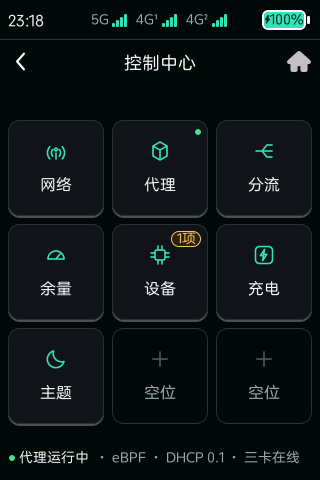
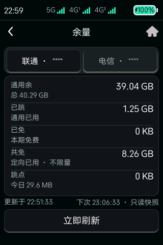
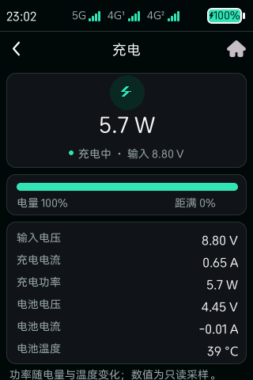
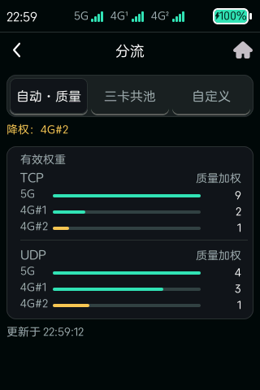
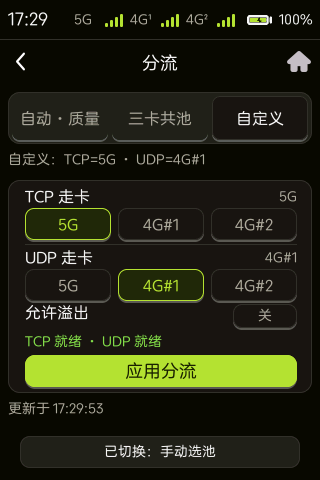
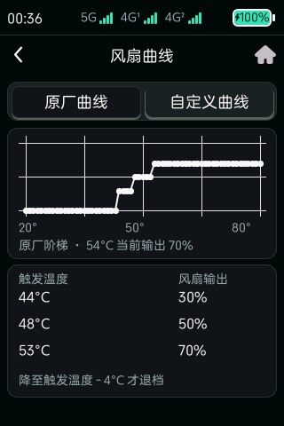
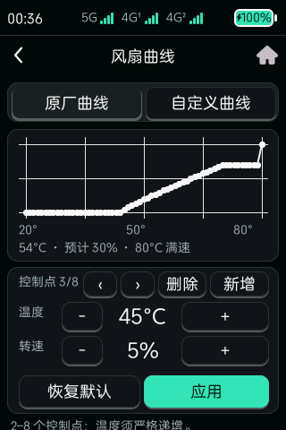
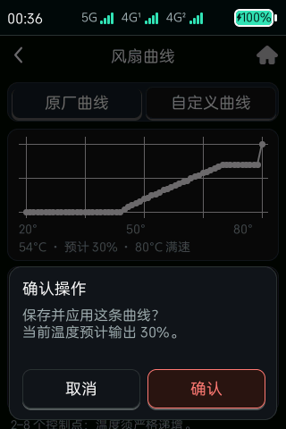

# 触屏控制中心实机截图

以下画面于 2026-08-29 从一台运行 B20 固件的 MU5252 实机只读抓取；「OpenDesign 还原页」
一节为 2026-11 整页还原后的补充抓图。实时数值只代表抓取时状态，不是示例配置或固定默认值。

公开图片使用不透明遮挡永久移除了号码、ICCID、IMSI、IMEI、模块序列号、IP、DNS、
信道、PCI、PLMN 和小区标识。仓库不包含未遮挡原图。

## 入口与网络概览

| 控制中心 | 三卡网络概览 |
| --- | --- |
|  |  |

## 蜂窝网络详情

| X75 无线参数 | X75 网络与承载 |
| --- | --- |
|  |  |

| X75 流量 | X75 趋势 |
| --- | --- |
|  |  |

| X75 SIM 与模块 | V3E2 无线参数 |
| --- | --- |
|  |  |

| V3E2 SIM 与模块 | V3E1 网络与承载 |
| --- | --- |
|  |  |

| V3E1 SIM 与模块 | Mihomo |
| --- | --- |
|  |  |

## 设备状态与控制

| 系统 | 全局流量 |
| --- | --- |
|  |  |

| 散热 | 风扇曲线 |
| --- | --- |
|  |  |

| Wi-Fi 功率 | 一键诊断 |
| --- | --- |
|  |  |

## OpenDesign 还原页（2026-11）

按 OpenDesign 原型整页还原的触屏页：九宫格控制中心、余量、充电、分流、风扇曲线。

| 九宫格控制中心 | 余量（运营商标签已遮挡） |
| --- | --- |
|  |  |

| 充电 | 分流 · 自动·质量 |
| --- | --- |
|  |  |

| 分流 · 自定义 | 风扇曲线 · 原厂阶梯 |
| --- | --- |
|  |  |

| 风扇曲线 · 自定义 | 风扇曲线 · 应用确认 |
| --- | --- |
|  |  |

> 余量页顶部两个运营商标签只保留「联通」「电信」，其后的号码后四位已用不透明色块盖成
> `联通 · ****` / `电信 · ****`。
>
> **出处**：余量查询的运营商协议参考
> [`ChinaTelecomOperators/ChinaUnicom`](https://github.com/ChinaTelecomOperators/ChinaUnicom)、
> [`ChinaTelecomOperators/ChinaTelecom`](https://github.com/ChinaTelecomOperators/ChinaTelecom)、
> [`margrop/telecom-phone-device-id-tools`](https://github.com/margrop/telecom-phone-device-id-tools)；
> 见仓库根目录 [`NOTICE.md`](../NOTICE.md)。
