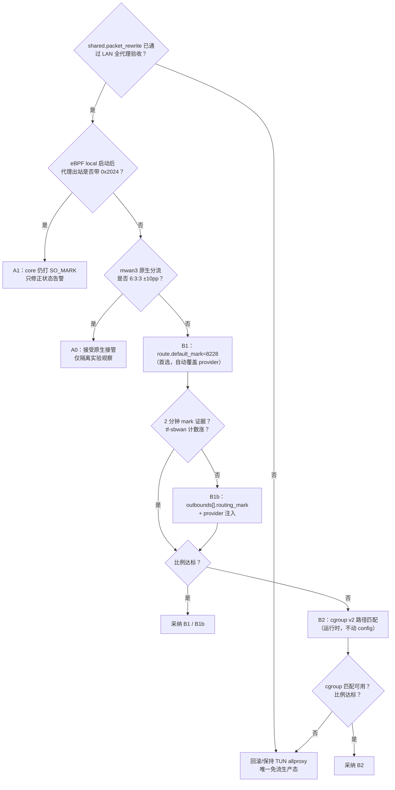

# 三卡分流 × eBPF 兼容方案（B20 / 2026-10-31）

> 范围：`singbox-wan-balance.sh` 的“代理出站识别”在 eBPF 入站下如何继续成立。
> 关联：`docs/TELEGRAM-E58695-SINGBOX-DIGEST-2026-10-30.md` §3.6、私人交接文档（未公开发布） §22.5 / §30 / §31、
> `docs/EBPF-MIGRATION-ROLLBACK-2026-10-31.md` §2 T3 / §3.1 / §3.2。
> 本文只给方案与验证口径，**不改设备、不改生产配置**；代码由 Main 按 B 思路集成，A 留作参考。

---

## 0. 先读：2026-10-31 免流硬约束（覆盖旧假设）

用户已拍板：本机是**免流**用途，验收标准不是“能上网”，而是：

| # | 约束 | 对三卡方案的直接影响 |
|---|---|---|
| 1 | **所有公网流量**（TCP/UDP、IPv4/IPv6、国内/国外）都必须进代理 | 三卡只负责“代理外层连接”选哪张卡；任何绕过代理的直连都算失败，不管它走哪张卡 |
| 2 | 只有 **LAN/私网目的** 和 **设备管理面** 可以 bypass | `bypass_private_address` 继续开；管理端口保持直连 |
| 3 | **Phase1 `local` only 不能作为静止态** | LAN 客户端会直连烧真实流量；local-only 只允许**隔离实验**（无 LAN 用户、维护窗口），不是“放行几分钟”；有 LAN 用户时严禁部署，实验结束必须回 TUN 或进 Phase2 |
| 4 | **`shared.enabled=false` 不算可接受降级** | eBPF shared 失败时，唯一生产降级是 **回滚 TUN allproxy**，不是“只留 local” |
| 5 | **IPv6 也必须代理** | 不给客户端发 `ipv4_only`、不封 v6；但要接受一个拓扑事实：**两张 4G 卡没有 IPv6**，v6 外层只能走 5G（见 §2.4） |

**因此有一个前置闸门：**

> `shared.packet_rewrite` 目前在 B20 上会卡 LAN TCP（HANDOVER §31.1，PC 全 000、握手通但数据不回）。
> 在这个问题定位前，**eBPF 任何档都不能作为免流生产态**；三卡方案可以先在隔离实验（无 LAN 用户）验证，
> 但生产切换必须等 shared 通过 LAN 全代理验收。当前生产是 `tun-allproxy`（HANDOVER §31.2），
> 三卡由 `SO_MARK 0x2024 + jhash` 正常工作（实测 55/22/27，§22.5），**不要为了 eBPF 先动它**。

**还有一个资费前提必须先确认：**

> 本方案默认**三张卡都享受同一免流资费/APN**，所以 6:3:3 把隧道外层发到任意一张卡都不产生真实计费。
> 如果只有 5G（或某一张卡）免流，按 6:3:3 均衡会把代理外层发到非免流卡，**三卡均衡本身就和免流目标冲突**。
> 这种情况下应改成“免流卡专用策略”（其余卡只做故障备份/探测），而不是继续追 6:3:3。
> 这一点需要用户确认资费口径；本文不替用户假设。

---

## 1. 现状与证据（先把事实钉死）

### 1.1 两条路径的差异

| 环节 | TUN 生产态（现在） | eBPF local（§30 实测） |
|---|---|---|
| 代理自身流量如何避开捕获 | `auto_route` 给每个出站 socket 打 `SO_MARK 0x2024`；`ip rule 9000 fwmark 0x2024 goto 9002`、`ip rule 32768 not from fwmark 0x2024 lookup 2022`、nft `inet sing-box` 里 `meta mark 0x2024 return` | eBPF 用 **socket-cookie map** 自绕过；HANDOVER §30 结论：**core 不再打 `0x2024`** |
| 代理出站进入 mwan3 时 | `0x2024 & 0x3f00 = 0x2000`，`mwan3_hook` 每条 `-m mark --mark 0x0/0x3f00` 都跳过 → mwan3 不分配 WAN | mark 为 0 → mwan3 **会**接管并分配 WAN；`mwan3` 原生 `balanced` 规则自己分流 |
| `tf-sbwan` 自定义链 | `meta mark == 0x2024` 命中，jhash 置 `0x0f000000`，`ip rule 1990-1992` 落 mwan3 接口表 12/13/14 | **计数器不涨**（§30）：匹配不到 `0x2024`，自定义链是 no-op |
| 实测比例 | 55/22/27（9 路并发，§22.5） | 44/23/34（9×8 MB，§30），由 mwan3 原生规则完成 |
| 可观测性 | `tf-sbwan` 三个桶计数 + `status` 的 `source: rule` | `source: ebpf`；自定义链计数不涨，只能看 `/proc/net/dev` |

### 1.2 一处文档口径冲突，按实测数据办

`singbox/README.md` 的“eBPF 下三卡分流的已知降级”写的是“分流实际失效，代理回落到 5G 单卡”；
但 HANDOVER §30 的实测是 **44/23/34**，由 mwan3 原生规则完成。两者不矛盾到“谁对谁错”的程度：

- 无 mark 时 mwan3 确实会接管本机 OUTPUT；只要 `default_rule_v4.use_policy=balanced`、
  三卡 tracker online、权重 6/3/3，它就会按连接分流；
- 但 mwan3 原生分流**不可控**：策略/权重/sticky 一改、或 `https` 规则的 sticky 命中，
  比例就会漂；而且没有 `tf-sbwan` 的桶计数可直接证明“代理流量”走了哪张卡。
- 所以 **A0（接受原生）只能作为“比例实测达标”的临时方案，不能作为设计目标**；
  要确定性，还是 B1/B2。

### 1.3 关键常量与优先级（后面方案要用）

| 项 | 值 | 说明 |
|---|---|---|
| 代理旁路 mark | `0x2024` = 8228 | TUN 下 core 自己打；eBPF 下默认不打 |
| mwan3 掩码 | `mmx_mask 0x3f00` | `0x2024 & 0x3f00 = 0x2000` → mwan3 跳过 |
| 自定义选卡位 | `0x0f000000` | 与 `0x3f00` 不重叠 |
| 自定义 ip rule | pref **1990-1992** → table 12/13/14 | 本脚本专用，`drop_rules` 只删带 `0x0f000000` 掩码的 |
| mwan3 自己的 ip rule | pref **2012-2014 / 2061-2062** | 见 HANDOVER §22.5 注；**pref 数字越小优先级越高**，1990 先于 2012 |
| 权重 | `zte_mwan2/3/4 = 6/3/3` = 50/25/25 | `mwan3-tuning/apply-rules.sh` |
| 三卡设备名 | `rmnet_data0` / `V3E1net0` / `V3E2net0` | `monitor-ebpf.sh` / `MONITORING.md` |

> **重要**：因为自定义规则 1990 的优先级高于 mwan3 的 2012，**只要包上带了 `0x0f000000` 选卡位，
> 即使 mwan3 已经先打了自己的低 8 位 WAN mark，最终仍会走我们选的表**。这是 B2（cgroup 匹配）
> 在 `mangle+3` 仍然可行的原因；也是 A0 下自定义链即使计数涨了也不一定改变结果的原因（它没涨）。

---

## 2. 冲突模型：为什么 TUN 能用、eBPF 会变

### 2.1 TUN（现在）

```
sing-box 出站 socket
  └─ SO_MARK 0x2024
       ├─ ip rule 9000：goto 9002（绕开 TUN 表 2022）
       ├─ nft inet sing-box：mark 0x2024 → return（不再 redirect）
       └─ mwan3_hook：mark & 0x3f00 = 0x2000 → 全部跳过
            └─ tf-sbwan（output mangle+3）：mark == 0x2024
                 └─ jhash(五元组) 置 0x0f000000 的一位
                      └─ ip rule 1990/1991/1992 → table 12/13/14
                           └─ mwan3 维护的 default via <gw> dev <if> src <WAN>
```

### 2.2 eBPF local（默认，不打 mark）

```
sing-box 出站 socket（cookie map 自绕过，无 SO_MARK）
  └─ mark = 0
       └─ mwan3_hook：命中 → 按 balanced 策略打 WAN mark（0x0100/0x0200/0x0400…）
            └─ ip rule 2012-2014 → table 12/13/14（mwan3 自己选）
                 └─ 结果：能分，但比例/粘性由 mwan3 决定，tf-sbwan 不参与
```

如果 mwan3 的策略不是 `balanced`、某张卡 tracker 掉线、或 `https` sticky 把新连接钉在同一张卡，
就会退化成“全走 5G”。这就是“旁路前提失效”的真实风险：**不是没有分流，而是分流不再由我们控制。**

### 2.3 显式 `routing_mark`（B1）

```
outbounds[i].routing_mark = 8228
  └─ core 在拨号 socket 上显式 setsockopt(SO_MARK, 0x2024)
       └─ 后面与 TUN 完全相同：mwan3 跳过 → tf-sbwan 命中 → ip rule 1990 → table 12/13/14
```

这就是“把 TUN 的隐式行为改成配置里的显式行为”，语义最干净。

### 2.4 cgroup 路径（B2）

```
启动时把 sing-box 进程放进 /sys/fs/cgroup/sing-box
  └─ nft tf-sbwan 用 socket cgroupv2 level 1 "sing-box" 匹配代理出站
       └─ jhash 置 0x0f000000
            └─ ip rule 1990（pref 1990 < mwan3 的 2012）→ table 12/13/14
```

注意两点：

1. **不需要 core 打 mark**；mwan3 就算先打了低 8 位，1990 仍会覆盖它的选表。
2. eBPF 的 local hook 仍挂在 cgroup 根（`local.cgroup_path` 省略），**子 cgroup 会被覆盖**；
   把 sing-box 放进子 cgroup 不会让它脱离捕获。

### 2.5 IPv6 的拓扑限制（不是代码 bug）

`tf-sbwan` 是 `table ip`，只有 IPv4；`ip rule 1990-1992` 也只对 v4 生效。
现网 **只有 5G 卡有 IPv6**（CHANGELOG 2026-10-27），两张 4G 没有 v6 默认路由。
所以：

- v4 代理外层：三卡 6:3:3；
- v6 代理外层：拓扑上只能走 5G，**不存在“三卡 v6 均衡”**；
- 免流约束下，v6 必须由一个**有 v6 出口的节点**承载；该节点的 v6 外层仍然从 5G 出，
  这部分流量是否免流取决于节点/卡，不由本脚本决定。
- 如果将来 4G 卡也拿到 v6，才需要新增 `table ip6 tf-sbwan` + `ip -6 rule`；现在不要提前做。

---

## 3. 免流红线下的 DIRECT 审计（必须先清）

`tun-allproxy` 已经是“零直连”目标档，但生成物里仍有下列直连。**三卡方案只覆盖代理外层，
覆盖不了这些直连**；它们不走代理，自然也不带 `0x2024`，属于免流验收的硬伤。

### 3.1 生成物里的直连清单（`singbox/generated/config.tun-allproxy.json`）

| # | 路径 | 现状 | 免流判定 | 建议 |
|---|---|---|---|---|
| 1 | 14 个 PT/BT 域 → `🌐 本机·本地直连` | `hdhome.org`、`t.hdhome.org`、`tracker.m-team.cc`、`rousi.zip`、`www.pttime.org`、`t.audiences.me`、`tracker.cinefiles.info`、`hhanclub.top`、`ptchdbits.co`、`tracker.ptchdbits.co`、`tracker.rainbowisland.co`、`ubits.club`、`chdbits.xyz`、`daydream.dmhy.best` | **违规**（公网直连） | 按免流红线应删除直连；除非用户明确把这 14 个域列为业务例外 |
| 2 | `private-domain` / `private-ip` → 直连 | LAN/私网 | **允许** | 保留 |
| 3 | `bootstrap` DNS `udp://223.5.5.5` | 无 `detour`，直连 | **违规**（公网 DNS） | 结构性例外：解析节点/DoH 域名需要它；要么把节点域名钉 IP，要么明确接受 |
| 4 | `ali` / `ali2` DoH（`doh.pub` / `dns.alidns.com`） | 无 `detour`，直连 | **违规** | 加 `"detour": "🚀 免流模式"`；注意别与 `domain_resolver: bootstrap` 自环 |
| 5 | `dns.final = ali` | 默认 DNS 走直连 DoH | **违规** | 改到代理 DNS，或把 `ali` 本身加 detour |
| 6 | `route.default_domain_resolver = ali` | 出站服务器域名解析直连 | **违规**（若节点用域名） | 节点尽量用 IP；否则这条会持续产生直连 DNS |
| 7 | `udp:53 → 🚀 免流模式` | 已代理 | OK | 保留（不要改成 DIRECT） |
| 8 | `🟢 直连模式` selector 仍含 `DIRECT` | 面板可选中 | **footgun** | allproxy 档删除该 selector 的 DIRECT 成员，或改名隐藏 |
| 9 | `🚀 专线机场` 默认 `DIRECT` | `DEFAULT_OVERRIDES` 里是直连，`ALL_PROXY_DEFAULT_OVERRIDES` 已改自动 | 生成物 OK，UI 可能被手动切回 | 验收时检查 selector 当前值 |
| 10 | ICMP / MPTCP / 非 TCP-UDP | TUN 只捕获 TCP/UDP；ICMP 内核本地应答 | **协议级例外** | 明确记录；不要声称“所有包都代理” |
| 11 | IPv4 分片 / 非 atomic IPv6 分片 | eBPF 文档明确会绕过接管 | **协议级例外** | 记录；不要用分片流量做验收 |

> 第 3/4/5/6 条是 DNS 侧直连，和“三卡选哪张卡”是两件事；但它们同样消耗真实流量，
> 必须在免流验收里单独清零。本文不展开 DNS 改造（属于 ConfigGen/IPv6 工单），只标记冲突。

### 3.2 三卡与 DIRECT 的关系

- 逐 outbound 的 `routing_mark` 不会覆盖内置 `direct`；`route.default_mark` 是否覆盖 direct
  取决于实现，**即使覆盖，direct 仍然是直连**（mark 只影响选卡，不会把它变成代理）；
- 直连流量会被 mwan3 原生规则分流，可能落在任意一张卡上——**看起来“三卡都在动”，实际是直连在烧流量**；
- **selector / urltest / loadbalance 的间接出口也要审计**：只要成员里含 `DIRECT_TAG`，
  用户手选或健康检查就可能选中直连；allproxy 档应把 `DIRECT` 从这些组里移除/隐藏，
  而不是只改默认值；
- 因此验收顺序必须是：**先证明没有公网直连，再看三卡比例**。否则比例再漂亮也不合格。

---

## 4. 决策树（Main 按 B 集成；A 留作参考）



**一句话选择**：

- 优先 **B1 `route.default_mark`**：一个路由字段覆盖 provider，改动最小、语义与 TUN 一致；
- `default_mark` 被二进制接受但不生效 → **B1b 逐 outbound `routing_mark` + provider 注入**；
- 不想动 config/provider、能接受启动包装器 → **B2 cgroup v2**；
- eBPF core 仍打 mark → **A1**（只修状态告警）；
- 只有隔离实验、且不接 LAN 用户时才允许 **A0**；生产降级只有 **TUN allproxy**。

---

## 5. 方案 A：保留 / 依赖 SO_MARK（最小改动）

### 5.1 A1：eBPF core 仍打 `0x2024`

**前提验证**（窗口内，只读）：

```sh
# 0) 先看现有链计数器（最轻，不动任何规则）
nft list chain ip tf-sbwan out
# 期望：三个 jhash bucket 的 counter 在下载时增长

# 1) conntrack 里找 8228（0x2024）
if [ -r /proc/net/nf_conntrack ]; then
  grep -c 'mark=8228' /proc/net/nf_conntrack
else
  conntrack -L 2>/dev/null | grep -c 'mark=8228'
fi

# 2) 临时 nft 计数器（窗口内加，测完删；只计数，不改包）
nft add table inet sbmark_probe
nft 'add chain inet sbmark_probe out { type route hook output priority mangle - 5; policy accept; }'
# 若上面的 priority 写法被 nft 拒绝，改用 priority -155（mangle = -150）
nft add rule inet sbmark_probe out meta mark 0x2024 counter
curl -4 -s -o /dev/null -m 10 https://www.gstatic.com/generate_204
nft list chain inet sbmark_probe out
nft delete table inet sbmark_probe
```

> **纠正一个常见命令**：`ss -tnp | grep sing-box` **看不到 SO_MARK**；`ss` 的 `-i/-e/-m`
> 也不显示 socket mark。判据用上面的 conntrack / nft 计数器，不要用 `ss` 的“mark 字段”做验收。

**如果 A1 成立**：

- nft 规则**不需要改**：`singbox_mark()` 在 eBPF 下会走 `ebpf` 分支，`MARK_VALUE` 仍是
  `FALLBACK_MARK=0x2024`，`build_spec()` 照样按 `0x2024` 匹配；
- 但 `status` 会显示 `source: ebpf` 并打印“自定义链是 no-op”的告警——**这句在 A1 下是误报**，
  需要把该分支改成“先看 `tf-sbwan` 计数器，涨了就是 A1，不涨才是 no-op”；
- 不需要新增 `routing_mark`，也不需要 cgroup；
- 风险：eBPF core 版本/配置一变就可能不打；每次升级后重跑 §5.1。

### 5.2 A0：core 不打 mark，但 mwan3 原生分流达标

§30 的实测就是这个状态：`tf-sbwan` 计数不涨，三卡 44/23/34。可作为**临时**方案。

**成立条件（缺一不可）**：

```sh
# 三卡都在 pool、权重 6/3/3
sh /data/sing-box/singbox-wan-balance.sh status
# 期望：3 行 pool；w=6/3/3；source: ebpf

# mwan3 默认策略必须是 balanced（不是 failover/某张卡固定）
uci get mwan3.default_rule_v4.use_policy    # balanced
uci get mwan3.https.use_policy              # balanced
uci get mwan3.https.sticky                  # 1（每条连接 sticky，可接受）
```

**必须改的只是“语义”**，不是数据面：

- `singbox_mark()` 在 eBPF 下返回 `MARK_SOURCE=ebpf`，`apply()`/`status()` 现在写的是
  “自定义链是 no-op，实际靠 mwan3”，这句是对的；但如果比例达标，不应再把它标成“失效”；
- 建议把提示改成“native mwan3（无 mark）”，并把验收判据固定为 `/proc/net/dev` 比例；
- `tf-sbwan` 可以保留（幂等、无副作用），也可以在确认 A0 长期化后 `singbox-wan-balance.sh clear`
  删掉自定义链，减少一层误解；**不要在没确认前删**，否则回 B1 要重新 apply。

**A0 的硬伤**：

- 比例由 mwan3 的策略/sticky/权重决定，**不受本脚本控制**；
- `https` 规则 `sticky=1 timeout=600` 可能让新连接在 10 分钟内偏向某张卡；
- 没有“代理流量”专属计数器，无法证明某张卡的增量一定来自代理而不是直连/探测；
- 一旦 mwan3 策略改成非 balanced，会直接退化成单卡，而 `status` 仍显示 `source: ebpf`。

→ **A0 只建议作为隔离实验的临时观察，不建议作为免流生产态的最终设计。**

---

## 6. 方案 B：显式识别代理出站

### 6.1 B1：`route.default_mark = 8228`（首选，覆盖 provider）

`route.default_mark` 是 1.14.4-reF1nd 的 `RouteOptions` 字段（schema
`$defs/RouteOptions/properties/default_mark`，integer 0..4294967295 或 string）。
它是**路由层默认 mark**，按 sing-box route 选项语义对所有出站连接生效——包括 provider 热加载进来的节点，
所以**不需要改 `update-providers.sh`，也不需要逐 outbound 注入**。
但“schema 有字段”不等于“该二进制在 eBPF 路径上真的落实”，必须以 §6.1.4 的 conntrack 证据为准。

> 旧 TUN 方案（`docs/SINGBOX-MIGRATION-PLAN-2026-10-27.md` §3.5）故意不设 `default_mark`，
> 因为 TUN 下 core 已经打 `0x2024`，再设会让 mwan3 跳过；但在 eBPF 下，这正是我们要的
> “把 TUN 的隐式 `SO_MARK` 变成显式默认值”。

#### 6.1.1 `singbox/convert.py` 改动（最小）

只给 eBPF profile 的 `route` 加一个字段：

```python
EBPF_ROUTING_MARK = 8228  # 0x2024

# build_config() 里：
route = build_route(clash, base, final, used_tags, all_proxy)
if profile.startswith("ebpf"):
    # 路由层默认 mark：所有出站连接（含 provider 节点）都继承。
    # TUN 档不加：TUN 的 core 已经打 0x2024，且不希望 direct 也被标。
    route["default_mark"] = EBPF_ROUTING_MARK
...
"route": route,
```

- 只影响 eBPF profile；`base` / `observability` / `tun-allproxy` 生成物不变；
- 不需要 `outbounds[]` 循环，provider 节点自动覆盖；
- `direct` 出站如果也继承该 mark，会被 jhash 链分流；它仍然是直连（见 §3 审计），
  **mark 不会把直连变成代理**；
- 生成后先在设备上 `./sing-box check -c config.json`，确认二进制接受该字段。

#### 6.1.2 `singbox-wan-balance.sh` 改动

`singbox_mark()` 现在只认 `ip rule` 和 `ebpf` 两态；加 `default` / `outbound` 两态，
顺序放在 `ebpf` 之前：

```sh
singbox_mark() {
    _m=$(ip rule show 2>/dev/null |
        sed -n 's/.*not from all fwmark \(0x[0-9a-fA-F]*\) lookup.*/\1/p' | head -1)
    if [ -n "${_m:-}" ]; then
        MARK_SOURCE=rule; MARK_VALUE="$_m"
    elif _rm=$(sed -n 's/.*"default_mark"[[:space:]]*:[[:space:]]*\([0-9][0-9]*\).*/\1/p' "$CONFIG" 2>/dev/null | head -1) && [ -n "${_rm:-}" ]; then
        MARK_SOURCE=default; MARK_VALUE=$(printf '0x%x' "$_rm")
    elif _rm=$(sed -n 's/.*"routing_mark"[[:space:]]*:[[:space:]]*\([0-9][0-9]*\).*/\1/p' "$CONFIG" 2>/dev/null | head -1) && [ -n "${_rm:-}" ]; then
        MARK_SOURCE=outbound; MARK_VALUE=$(printf '0x%x' "$_rm")
    elif grep -q '"type": "ebpf"' "$CONFIG" 2>/dev/null; then
        MARK_SOURCE=ebpf; MARK_VALUE="$FALLBACK_MARK"
    else
        MARK_SOURCE=fallback; MARK_VALUE="$FALLBACK_MARK"
    fi
}
```

- `build_spec()` 继续用 `$MARK_VALUE`，nft 规则不用改；
- `apply()` / `status()` 加 `default` / `outbound` 分支：打印
  “explicit route.default_mark / outbound.routing_mark”，**不再告警 no-op**；
- 若 config 里是字符串 `"0x2024"`，上面的 sed 不匹配；统一用整数 8228；
- `default_mark` 是全局的，覆盖检查只需要确认 config 里有这个字段；不需要数 provider。

#### 6.1.3 前置检查：别让旧 TUN 规则抢路由

```sh
# eBPF 档不应存在这两条（auto_route 的 TUN 旁路）
ip rule show | grep -E 'fwmark 0x2024|lookup 2022'
nft list ruleset | grep -n '0x2024' | head
```

- 如果有 `9000: from all fwmark 0x2024 goto 9002`，它会 **先于 1990** 生效，把包送进 TUN 表，
  造成“mark 有了但选卡不生效”或环路；
- 先确认 `sbtun0` 不存在、TUN 没在跑，再由 `sing-box.sh stop` 正常清理；**不要盲删**；
- 如果清不掉，B1 可改用 `0x2025`（同样 `& 0x3f00 = 0x2000`，但避开旧 0x2024 规则），
  同时把 `FALLBACK_MARK`/`default_mark`/nft 匹配一起改；这是应急，不是首选。

#### 6.1.4 B1 验收

```sh
sh /data/sing-box/singbox-wan-balance.sh status
# 期望：source: default；pool 3 行；ip rules 1990-1992 存在

nft list chain ip tf-sbwan out
# 期望：下载时三个 bucket counter 增长

if [ -r /proc/net/nf_conntrack ]; then
  grep -c 'mark=8228' /proc/net/nf_conntrack
else
  conntrack -L 2>/dev/null | grep -c 'mark=8228'
fi
# 期望：>0（代理外层连接带 mark）
```

然后跑 §7.2 的比例测试；达标即采纳。**如果 `sing-box check` 接受 `default_mark`、
但 conntrack 里始终没有 `mark=8228`**，说明该二进制没有落实这个字段（或 eBPF 路径绕过了 dialer），
进入 §6.1.5 的逐 outbound 兜底。

**B1 失败模式**：

| 现象 | 原因 | 处理 |
|---|---|---|
| `source: fallback/ebpf`，不是 `default` | config 里没有 `default_mark` 或不是整数 | 重新生成/检查字段 |
| mark 证据为 0 | 二进制接受但未落实 `default_mark` | 进入 §6.1.5 |
| mark 有、`tf-sbwan` 计数不涨 | 旧 TUN `ip rule 9000` 抢路由，或链 priority 被改 | 清旧规则/检查 `nft list chain` |
| 比例仍单卡 | mwan3 表/网关/pool 问题，不是 mark | 看 `status` 的 pool 和 `ip route show table 12` |
| `sing-box check` 报未知字段 | 二进制不是 1.14.4-reF1nd / schema 不匹配 | `sing-box version`；回 A0 |

#### 6.1.5 兜底：`outbounds[].routing_mark` + provider 注入

只有 §6.1.4 证明 `route.default_mark` 不被落实时才用。`routing_mark` 是 outbound 公共字段
（schema `$defs/Outbound` 的 vmess 定义里已确认），语义与 `default_mark` 相同，但只覆盖被显式标记的 outbound。

`convert.py`：在 `build_config()` 组装完 `outbounds` 后，仅对 eBPF profile 注入：

```python
if profile.startswith("ebpf"):
    for o in outbounds:
        # 只标真实代理；direct/block/selector/urltest/loadbalance 不标。
        # 给 direct 标 0x2024 会让直连也跳过 mwan3，反而全钉 5G。
        if o.get("type") not in ("direct", "block", "selector", "urltest", "loadbalance"):
            o["routing_mark"] = EBPF_ROUTING_MARK
```

**provider 节点不在 `outbounds` 里**（运行时热加载），必须同时改 `update-providers.sh`，
否则只有本地 14 个 vmess 被标记，provider 流量仍走 mwan3 原生，形成混合态。

注入（busybox sed，幂等）：

```sh
# update-providers.sh：curl 成功、校验 '"outbounds"' 之后，mv 之前
sed -e 's/"routing_mark": [0-9][0-9]*, //g' \
    -e 's/"server":/"routing_mark": 8228, "server":/g' \
    "$tmp" > "$tmp.marked" || { rm -f "$tmp" "$tmp.marked"; log "MARK FAIL $tag"; continue; }
mv "$tmp.marked" "$tmp"
```

- 只匹配 `"server":`，不会碰 `"server_port"` / `"server_name"`；
- 先删旧 `routing_mark` 再插，重复跑不会产生重复 key；
- provider 里的 `selector/urltest` 没有 `"server":`，不会被误标；
- 占位 `{"type":"socks","server":"127.0.0.1"}` 会被标，但它不可用，无影响。

**覆盖检查**（仅兜底路径需要；避开 DNS 的 `"server":` 和嵌套的 `"outbounds":`）：

```sh
cd /data/sing-box
# 本转换器目前只会产出 vmess 本地节点；provider 文件里每个真实节点都有 "server"。
# 不要用 sed 截 "outbounds" 段：selector 内部也有嵌套的 "outbounds"/"providers" 键。
want=$(( $(grep -o '"type": "vmess"' config.json | wc -l) \
       + $(cat providers/*.json 2>/dev/null | grep -o '"server":' | wc -l) ))
have=$(( $(grep -o '"routing_mark": 8228' config.json | wc -l) \
       + $(cat providers/*.json 2>/dev/null | grep -o '"routing_mark": 8228' | wc -l) ))
echo "routing_mark coverage: $have/$want"
# 期望 have >= want；少一个都说明有代理节点会绕过自定义链
```

> BusyBox 的 `grep -o` 在个别精简构建里没有；没有时按文件用 `grep -c` 统计再相加。
> 不要用整个 `config.json` 直接数 `"server":`，会把 DNS 的 `"server": "doh.pub"` 等
> 算成“未标记节点”。将来支持 vmess 以外的本地节点时，`want` 的统计要跟着改。

### 6.2 B2：cgroup v2 路径匹配（备选，覆盖 provider 最全）

适用于：`route.default_mark` 和逐 outbound `routing_mark` 都不适用，或不想动 config/provider。

#### 6.2.1 前提

```sh
# cgroup2 已挂载且可写（§30 已确认：cgroup2 on /sys/fs/cgroup rw）
mount | grep cgroup
ls -ld /sys/fs/cgroup

# 设备没有 systemd，/sys/fs/cgroup/system.slice/sing-box.service 不存在；
# 不要照抄 systemd 路径。
ls -d /sys/fs/cgroup/system.slice 2>/dev/null || echo "no systemd (expected)"

# 当前 sing-box 在哪个 cgroup
cat /proc/$(cat /data/sing-box/state/sing-box.pid)/cgroup
# 典型：0::/  → 需要移到 /sing-box

# nft 是否支持 socket cgroupv2（先建目录，避免 nft 校验路径不存在）
mkdir -p /sys/fs/cgroup/sing-box
nft --version
nft add table inet cgtest
nft 'add chain inet cgtest out { type route hook output priority mangle + 3; policy accept; }'
nft add rule inet cgtest out socket cgroupv2 level 1 "sing-box" counter
nft list chain inet cgtest out
nft delete table inet cgtest
```

- 如果最后一条 `nft add rule` 报 unknown expression，B2 不可用，回 B1/A0；
- `meta skuid` 不推荐：sing-box 由 `start-stop-daemon` 以 **root** 启动（[INFERENCE] 需
  `ps -o user,pid,args | grep sing-box` 复核），`meta skuid 0` 会匹配所有 root 进程
  （dnsmasq/netifd/脚本），范围太大；为它单独建 uid 又要放弃 eBPF/TUN 所需权限，不值得。

#### 6.2.2 启动包装器

新增 `/data/sing-box/singbox-cgroup-exec.sh`：

```sh
#!/bin/sh
CG=/sys/fs/cgroup/sing-box
mkdir -p "$CG" 2>/dev/null || true
[ -w "$CG/cgroup.procs" ] || { echo "cgroup not writable: $CG" >&2; exit 1; }
echo $$ > "$CG/cgroup.procs" || exit 1
exec /data/sing-box/sing-box run -c /data/sing-box/config.json
```

`sing-box.sh` 的 `start_core()` 在 eBPF 模式下改用这个 wrapper（TUN 模式保持原命令），
并保留 `sing-box check`、pid 文件、`wait_api` 逻辑。注意：

- `exec` 后 pid 不变，`state/sing-box.pid` 仍指向 core；
- 如果 `cgroup.procs` 写入失败，直接启动失败，不要静默回退到 root cgroup（否则匹配不到）；
- 回滚时恢复原启动命令，并 `rmdir /sys/fs/cgroup/sing-box`（空目录才可删）。

#### 6.2.3 nft 规则改动

`build_spec()` 在 B2 模式下把首行 `meta mark != $_mark counter return` 换成 cgroup 匹配，
并且每个 bucket 规则都带 cgroup 表达式：

```text
table ip tf-sbwan {
    chain out {
        type route hook output priority mangle + 3; policy accept;
        socket cgroupv2 level 1 "sing-box" jhash ip daddr . th sport . th dport mod 100 seed 0x9e3779b9 0-49 counter meta mark set meta mark | 0x01000000
        socket cgroupv2 level 1 "sing-box" jhash ... 50-74 counter meta mark set meta mark | 0x02000000
        socket cgroupv2 level 1 "sing-box" jhash ... 75-99 counter meta mark set meta mark | 0x04000000
        counter return
    }
}
```

- 不需要 `meta l4proto` 判断也可以，jhash 只对 tcp/udp 有意义；保留 `meta l4proto != { tcp, udp } return`
  更稳（放在 cgroup 规则前）；
- **不要**写成 `socket cgroupv2 ... counter return`（极性反了，会把代理流量直接放过）；
- 计数器保留在每条 bucket 上，`status` 仍可看命中。

#### 6.2.4 B2 验收

```sh
cat /proc/$(cat /data/sing-box/state/sing-box.pid)/cgroup
# 期望：0::/sing-box

nft list chain ip tf-sbwan out
# 期望：cgroup 表达式 + 三个 bucket counter

sh /data/sing-box/singbox-wan-balance.sh status
# 期望：source: cgroup（脚本需加该分支）
```

比例测试同 §7.2。B2 的风险：nft 版本、cgroup 写入权限、启动包装器与 watchdog 的交互；
任何一项不满足就回 B1。

### 6.3 关于 `bypass_private_address`（纠正一个误解）

`local.bypass_private_address` / `shared.bypass_private_address` 的语义是：
**目的地址是私网/特殊用途时，不被 eBPF 捕获**。它解决的是“LAN/私网不要进代理”，
**不是**“让代理自己的出站绕过 mwan3”，也**不能**用来识别代理出站。

- 所有 eBPF profile 里它已经是 `true`；
- 它不会给代理 socket 打 mark，不会改变 mwan3 的选卡；
- 免流约束下它正好是“LAN/私网允许 bypass”的实现，保持即可；
- 不要指望它解决三卡问题。

---

## 7. 验证清单（按阶段，命令可直接抄）

### 7.1 窗口前（只读，2 分钟）

```sh
cd /data/sing-box

# 1) 当前模式与进程
sh sing-box.sh status
# 期望：core running / api / in: ebpf (...) / tun 为空（eBPF）

# 2) 没有双捕获
ip link show sbtun0 2>/dev/null && echo "TUN STILL UP" || echo "no tun (ok for ebpf)"

# 3) pool 与 mark 来源
sh singbox-wan-balance.sh status
# 期望：3 行 pool；source: rule/default/outbound/cgroup/ebpf

# 4) 旧 TUN 规则残留（B1 必查）
ip rule show | grep -E 'fwmark 0x2024|lookup 2022' || echo "no tun rules (ok)"

# 5) 配置校验
./sing-box check -c config.json && echo CHECK_OK
```

### 7.2 并发比例（核心验收）

设备本机（eBPF local / TUN 都会捕获本机 curl）：

```sh
snap() { awk '/rmnet_data0|V3E1net0|V3E2net0/{gsub(":","",$1);print $1,$2}' /proc/net/dev; }
snap > /tmp/rx.before
i=0
while [ "$i" -lt 9 ]; do
    curl -4 -s --max-time 60 -o /dev/null \
      'https://speed.cloudflare.com/__down?bytes=8000000' &
    i=$((i + 1))
done
sleep 30
snap > /tmp/rx.after
wait
awk 'NR==FNR{b[$1]=$2;next}{d=$2-b[$1];t+=d;D[$1]=d}
     END{for(k in D)printf "%s %.1f MB %.0f%%\n",k,D[k]/1048576,100*D[k]/t}' \
     /tmp/rx.before /tmp/rx.after
```

判读（权重 6/3/3）：

| 结果 | 判定 |
|---|---|
| 三卡 ≈ 50/25/25，单卡偏差 ≤10pp | 通过 |
| 三卡都 >10%，但偏差 10-20pp | 观察；连测两次再定 |
| 5G >90%，或任一在线 4G <5% | **失败**（单卡钉死） |
| 总吞吐 <1 MB/30s | **失败**（黑洞/节点问题，不是分流） |

> LAN 客户端路径（Phase2）把上面的 `curl` 放到 PC 上跑，设备只读 `/proc/net/dev`；
> 同时用 `/observability/v1/connections/active` 确认连接确实进了 `ebpf-in`/`tun-in`。

### 7.3 “确实走代理”证据（免流）

```sh
# 近期连接：inbound 必须是 ebpf-in/tun-in 或 mixed-in；outbound 不能是直连（公网目的）
curl -s http://127.0.0.1:9999/observability/v1/connections/recent \
  | tr ',' '\n' | grep -E 'inbound|outbound|destination' | head -40

# 当前活动连接
curl -s http://127.0.0.1:9999/observability/v1/connections/active | head -c 500; echo

# mwan3 日志里是否出现“未标记/直连”可疑流（可选）
logread | grep -i mwan3 | tail -20
```

- 任何公网目的、`outbound` 为 `🌐 本机·本地直连` 的连接 = **免流失败**；
- 14 个 PT 域、DNS bootstrap/ali/ali2 的直连按 §3 单独记账，不要混进“三卡比例”里。

### 7.4 mark / cgroup 证据

```sh
# B1
if [ -r /proc/net/nf_conntrack ]; then
  grep -c 'mark=8228' /proc/net/nf_conntrack
else
  conntrack -L 2>/dev/null | grep -c 'mark=8228'
fi
nft list chain ip tf-sbwan out          # bucket counter 增长

# B2
cat /proc/$(cat /data/sing-box/state/sing-box.pid)/cgroup
nft list chain ip tf-sbwan out          # cgroup 规则 counter 增长

# A0/A1
sh singbox-wan-balance.sh status        # source + pool
```

### 7.5 失败判据汇总

| # | 判据 | 动作 |
|---|---|---|
| F1 | 任一 LAN/公网流未进代理（observability 无记录 / 直连 outbound） | 立即回 TUN；免流红线 |
| F2 | 5G 占比 >90% 或在线 4G <5%，连续两次 30s | 回上一档；B1/B2 不成立 |
| F3 | `tf-sbwan` counter 不涨，但 mark/cgroup 证据存在 | 链/优先级/旧规则问题；修不好回 TUN |
| F4 | `source: fallback` 且三卡不均 | 识别失败；回 TUN |
| F5 | `sbtun0` 仍存在 / 双捕获 | 立即停 core，清理 TUN，再起 |
| F6 | 总吞吐崩塌、TCP reset、DNS 全挂 | 立即回 TUN |
| F7 | 公网直连（PT/DNS/ICMP）未清零 | 免流验收不通过，不进入生产 |

---

## 8. 降级路径（按免流约束重写）

```
B2 失败
  └─ B1 失败
       └─ A0 比例不达标
            └─ 回滚 TUN allproxy（唯一生产态）
```

- **Phase1 local-only 不是降级档**：它只允许**隔离实验**（无 LAN 用户），不是“放行几分钟”；实验结束必须回 TUN 或进 Phase2。
- **shared=false 不是降级档**：LAN 客户端会直连烧流量，违反免流；不作为可接受状态。
- **A0 也不是最终降级档**：只是“窗口内比例达标”的临时观察；长期不可控。
- 生产回滚命令（与回滚手册 §3.2 一致）：

```sh
cd /data/sing-box
# 只用 backup-config.sh 维护的、验证过的 tun 阶段快照（别名 config.json.bak-tun）。
# restore 会带 md5 校验、自动安全备份、≤30s 计时。
sh backup-config.sh restore tun

# 验证
sh sing-box.sh status                 # tun: sbtun0 UP
sh singbox-wan-balance.sh status      # source: rule；pool 3 行
curl -4 -s -o /dev/null -w '%{http_code}\n' https://www.gstatic.com/generate_204  # 204
```

> **不要用 `config.json.bak-tunallproxy-20261030T060135Z` 回滚 TUN**：它是部署 TUN 之前
> 的 **旧 eBPF allproxy2**（HANDOVER §31.2 写明 md5 `5288a884…` = 旧 eBPF allproxy2），
> 不是 TUN 快照。TUN 快照只认 `backup-config.sh` 的 `tun` 阶段别名 / 它校验过的
> `config.json.bak-tun`；两者不一致时以 `backup-config.sh list`/md5 为准。

- 代码回滚：`convert.py` / `update-providers.sh` / `sing-box.sh` / `singbox-wan-balance.sh`
  都从 git 或设备 `.bak` 恢复；恢复后重新生成 config、`sing-box check`、restart。
- `singbox-wan-balance.sh clear` 会删 `tf-sbwan` 和 1990-2012 的自定义规则，**不会碰 mwan3**；
  回 TUN 后必须 `apply` 重新装回，否则 `source: rule` 但链不存在。

---

## 9. 对比表

### 9.1 SO_MARK vs routing_mark vs cgroup 路径（核心表）

| 维度 | **SO_MARK 0x2024（core 隐式，A1）** | **route.default_mark=8228（B1）** | **outbounds[].routing_mark=8228（B1b）** | **cgroup v2 路径（B2）** |
|---|---|---|---|---|
| 识别对象 | core 自己给所有出站 socket 打标 | 路由层默认值，所有出站 dialer 继承 | 仅被显式标记的 outbound | 进程所在 cgroup 里的 socket |
| 生效时机 | TUN auto_route 启动时 | 每个出站拨号时（默认值） | 每个 outbound 拨号时 | 包出 OUTPUT 时（socket 归属） |
| 改动面 | 无 | `convert.py` 一个 route 字段 + 脚本识别 | `convert.py` 循环 + `update-providers.sh` 注入 + 脚本识别 | 启动包装器 + `wan-balance.sh` nft 表达式 |
| 覆盖 provider 节点 | 全覆盖 | **全覆盖**（路由层） | **取决于注入**；漏一个就是混合态 | 全覆盖 |
| 覆盖 DIRECT 出站 | 会（direct 不该有） | 可能（取决于实现）；但仍是直连 | 不会（内置 direct 不能标） | 会（cgroup 内所有 socket） |
| 与 mwan3 关系 | `0x2000` 位让 mwan3 跳过 | 同左 | 同左 | mwan3 可能先打低 8 位，但 1990 优先级更高，仍按我们的表 |
| 可观测性 | `tf-sbwan` 计数 + conntrack mark | 同左；无需覆盖率统计 | 同左 + 需覆盖率统计 | cgroup 规则计数；无 mark 可看 |
| 主要风险 | eBPF core 不再打（已发生） | 二进制接受但不落实；旧 9000 规则抢路由 | provider 漏标/JSON 改写损坏；旧 9000 规则 | nft 不支持 cgroupv2 / cgroup 写入失败 / 启动包装器复杂 |
| 回滚 | 无（本来就没改） | 重新生成 config（去掉字段） | 恢复 config/脚本，`apply` | 恢复启动命令，删 cgroup，`apply` |
| IPv6 | mark 对 v6 也生效，但 `table ip` 不选 v6 | 同左 | 同左 | 同左 |
| 推荐 | 仅 TUN / 确认 core 仍打标时 | **eBPF 首选**（最小、覆盖 provider） | `default_mark` 不生效时兜底 | 不想动 config/provider 时的备选 |

### 9.2 可选状态总表

| 状态 | 代理出站识别 | 三卡控制 | 免流合规 | 生产可用 | 备注 |
|---|---|---|---|---|---|
| TUN allproxy（现在） | SO_MARK | jhash 6:3:3 | 接近（DNS/PT 待清） | **是** | 唯一已验证生产态 |
| eBPF A0 | 无（mwan3 原生） | mwan3 策略 | 取决于 shared | 否（shared 卡 LAN） | 仅隔离实验观察 |
| eBPF B1 | `route.default_mark` | jhash 6:3:3 | 取决于 shared | shared 修好后可 | **首选**；自动覆盖 provider |
| eBPF B1b | `outbounds[].routing_mark` + provider 注入 | jhash 6:3:3 | 取决于 shared | shared 修好后可 | `default_mark` 不生效时兜底 |
| eBPF B2 | cgroup | jhash 6:3:3 | 取决于 shared | shared 修好后可 | 备选；不动 config |

---

## 10. 实施顺序（Main 按 B 集成；A 为参考）

| 阶段 | 动作 | 验收 | 回滚 |
|---|---|---|---|
| G0 | 修 `shared.packet_rewrite` LAN TCP（§31.1） | PC 全代理 200/204、observability 有记录 | 回 TUN |
| G1 | 清 DIRECT：14 PT、DNS detour、selector 直连 | §7.3 无公网直连 | 恢复 config |
| G2 | 先加 `route.default_mark=8228`（eBPF profile），生成 + `sing-box check` + 2 分钟 mark 证据 | `source: default`、conntrack 8228、tf-sbwan 计数 | git/备份 |
| G2b | 仅当 `default_mark` 被接受但不生效：逐 outbound `routing_mark` + provider 注入 | 覆盖率 `have>=want`、`source: outbound` | git/备份 |
| G2c | 仅当 G2/G2b 都不行：B2 cgroup 路径 | `source: cgroup`、cgroup 计数器 | 恢复启动命令 |
| G3 | 隔离实验（local only，无 LAN 用户） | §7.2 比例 + §7.4 证据 | 立即回 TUN |
| G4 | Phase2（shared）+ LAN 客户端验收 | PC 200/204、比例、无直连 | 回 Phase1/TUN |
| G5 | 生产切换 + 24h 观察 | 三卡比例、DNS、IPv6、面板 | 一键回 TUN |

**代码验收（不跑全量测试，只跑相关）：**

```sh
python singbox/convert.py --profile ebpf-local-shared --out /tmp/ebpf.json
python - <<'PY'
import json
c=json.load(open('/tmp/ebpf.json'))
print('route.default_mark:', c['route'].get('default_mark'))          # 期望 8228（B1）
prox=[o for o in c['outbounds'] if o.get('type') not in ('direct','block','selector','urltest','loadbalance')]
print('outbound routing_mark:',sum(1 for o in prox if o.get('routing_mark')==8228),'/',len(prox))  # B1b 才期望全标
PY
sh -n singbox/singbox-wan-balance.sh
sh -n singbox/update-providers.sh
sh -n singbox/sing-box.sh
```

设备侧再跑 `./sing-box check -c config.json`；`default_mark` / `routing_mark` 不被识别会在这里直接失败。
如果 `check` 通过但 conntrack 没有 `mark=8228`，才进入 B1b；不要直接把 B1 判死。

---

## 11. 与回滚手册的差异（需要主代理合并口径）

`docs/EBPF-MIGRATION-ROLLBACK-2026-10-31.md` 里有两处按旧假设写的，需要按免流约束更新：

1. **“Phase1 下 LAN 不过代理（设计如此）”** → 现在只能作为隔离实验（无 LAN 用户），不能作为静止态；
   生产要么 Phase2 shared，要么 TUN。
2. **T3 的三卡判据** → 保留“>90% 单卡”作为失败判据，补充“任一在线 4G <5%”；
   并且 eBPF 下 `source: ebpf` 不再自动等于“自定义链 no-op 可接受”，
   B1/B1b/B2 落地后应期望 `source: default` / `source: outbound` / `source: cgroup`。

本文不改那两份文档（避免并发编辑冲突），只在这里记录差异。

---

## 12. 附：关键证据索引

| 结论 | 出处 |
|---|---|
| TUN 下 `SO_MARK 0x2024` 与 mwan3 `0x3f00` 冲突、jhash 补丁、55/22/27 | HANDOVER §22.5 |
| eBPF 不再打 `0x2024`、`tf-sbwan` 计数不涨、mwan3 原生 44/23/34 | HANDOVER §30 |
| eBPF `shared.packet_rewrite` 卡 LAN TCP | HANDOVER §31.1 |
| 现网 TUN allproxy、md5；`bak-tunallproxy-…` 实为旧 eBPF allproxy2（不是 TUN） | HANDOVER §31.2 |
| eBPF 自绕过用 socket-cookie map、耦合点清单 | Telegram digest §3.1/§3.6 |
| `bypass_private_address` 语义、`cgroup_path` 默认根层级 | `tmp/tg-e58695/ebpf-doc-1.14.4.md` |
| `route.default_mark` 在 RouteOptions 里 | `tmp/tg-e58695/schema.json`（`$defs/RouteOptions/properties/default_mark`） |
| `routing_mark` 在 outbound 公共字段 | `tmp/tg-e58695/schema.json`（`$defs/Outbound` vmess） |
| mwan3 规则 2012-2014 / 2061-2062 | HANDOVER §22.5 注 |
| 只有 5G 有 IPv6 | CHANGELOG 2026-10-27 三卡分流条 |
| 14 个 PT 直连域 | `singbox/convert.py` `PT_DIRECT_DOMAINS`；生成物 rules 8-21 |
| DNS 直连（bootstrap/ali/ali2/final） | 生成物 `dns.servers` / `dns.final` |

---

**最终建议（一句话）**：现在生产保持 TUN allproxy；等 `shared.packet_rewrite` 修好后，
先给 eBPF profile 加 **`route.default_mark=8228`（B1）**，用 `sing-box check` + conntrack
`mark=8228` + `tf-sbwan` 计数 + 6:3:3 比例验收；若二进制接受但不落实，再走
**B1b（逐 outbound `routing_mark` + provider 注入）**；两者都不行才上 **B2（cgroup 路径）**。
**A0 只做隔离实验观察；local-only（尤其有 LAN 用户时）和 shared=false 都不算免流降级。**
