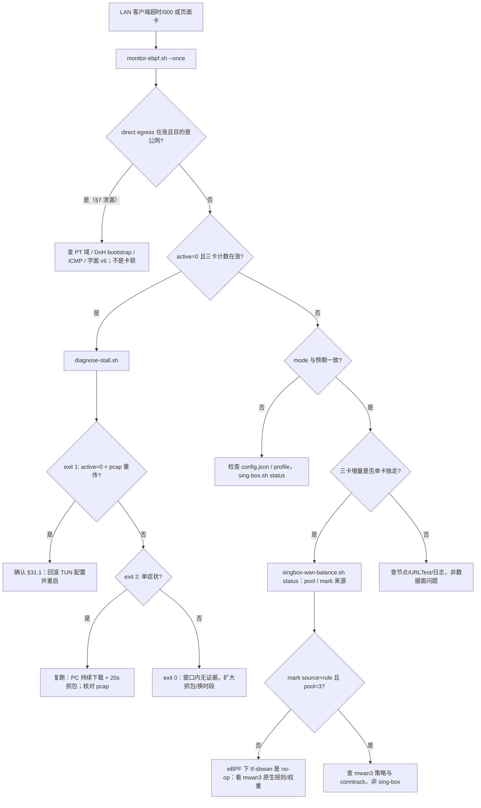

# eBPF 迁移监控与诊断（B20）

面向 **ZTE TopFlow MU5252（B20，kernel 5.15.194-perf，OpenWrt 23.05.4）** 的
TUN → eBPF（`local` → `shared.packet_rewrite`）迁移监控包。所有工具只读，
不改路由、不挂载 BPF、不重启内核；唯一写入是诊断 pcap 和监控快照。

```
设备 /data/sing-box/
├── monitor-ebpf.sh            实时屏幕（observability + 三卡差分 + 分流状态）
├── diagnose-stall.sh          §31.1 卡顿三症状取证（active/clash、pcap 重传、探测漂移）
├── wan-metrics-exporter.sh    三卡 Prometheus 导出器（:9102，busybox httpd 静态文件）
├── prometheus-scrape.yml      Prometheus 抓取配置（PC/NAS 侧）
├── grafana-dashboard.json     Grafana 11.6+ 面板（官方模板 + 三卡自定义 panel）
└── MONITORING.md              本文件
```

现网口径（2026-10-30 晚起）：`tun-allproxy`（TUN `sbtun0`，全代理），
observability 已开、`clash_api.secret=""`（用户规则，HANDOVER §29）。
eBPF `shared.packet_rewrite` 会卡 LAN TCP（§31.1），只作实验档。

> **硬约束（2026-10-31 用户拍板，优先于本文旧口径）**：本部署用于**免流**。
> TCP/UDP、IPv4/IPv6、国内/国外，**所有报文必须走代理**；唯一允许绕过的是
> LAN/私网目的和设备管理面。LAN 直连、DNS 直连、ICMP 直连、MPTCP 子流都算失败。
> `local-only` 不能作为驻留状态；`shared` 关闭不是可接受的降级。
> 现网 `tun-allproxy` 仍有 14 个 PT 域 + DNS DoH/bootstrap 直连（见 §7），
> 它是**稳定性回滚档，不是零直连合规档**。

---

## 1. 设备侧快速开始

```sh
# 实时监控（Ctrl-C 退出；重定向即落盘）
sh /data/sing-box/monitor-ebpf.sh
sh /data/sing-box/monitor-ebpf.sh --interval 2
sh /data/sing-box/monitor-ebpf.sh --once
sh /data/sing-box/monitor-ebpf.sh > /data/sing-box/diagnostics/monitor.log 2>&1 &

# 卡顿取证（默认 br-lan、443/80、抓 10 秒；需要 tcpdump）
sh /data/sing-box/diagnose-stall.sh
sh /data/sing-box/diagnose-stall.sh --seconds 20 --count 800
sh /data/sing-box/diagnose-stall.sh --no-capture     # 没装 tcpdump 时

# 三卡导出器（一次性自检；正常应输出 15 行左右指标）
sh /data/sing-box/wan-metrics-exporter.sh
nohup sh /data/sing-box/wan-metrics-exporter.sh --serve 9102 \
  >/tmp/wan-exporter.log 2>&1 &

# 三卡分流状态（pool + bypass mark 来源）
sh /data/sing-box/singbox-wan-balance.sh status

# 免流泄漏自检：direct 出站计数与直连标签
sh /data/sing-box/monitor-ebpf.sh --once | grep 'direct egress'
curl -s 'http://127.0.0.1:9999/observability/v1/top?dimension=outbound&limit=100' \
  | jq -r '.data[] | select(.value|test("直连|DIRECT|direct")) | "\(.value) conns=\(.connections)"'
```

`monitor-ebpf.sh` 每秒/每周期只做 4 次本地 HTTP + 3 次 `/proc/net/dev` 读取；
`diagnose-stall.sh` 会产生 10 秒 pcap（`diagnostics/stall-<utc>.pcap`），
抓包期间对转发性能有轻微影响。

开机自启（仓库统一用 `rc.local`，rcS 不执行 overlay 的 init.d）：

```sh
# /etc/rc.local 的 exit 0 之前
nohup sh /data/sing-box/wan-metrics-exporter.sh --serve 9102 \
  >/tmp/wan-exporter.log 2>&1 &
```

---

## 2. 数据源与可信度

| 数据源 | 路径 | 说明 |
|---|---|---|
| observability | `http://127.0.0.1:9999/observability/v1/*` | 与 Clash Controller 同端口；本项目无 secret |
| Prometheus 文本 | `/observability/v1/metrics` | 有界指标，标签只有维度名，不含域名/IP |
| 内核三卡计数 | `/proc/net/dev` | `rmnet_data0` / `V3E1net0` / `V3E2net0`，单位为字节 |
| mwan3 状态 | `/tmp/run/mwan3/iface_state/*` | `online` 才算可用卡 |
| 分流状态 | `singbox-wan-balance.sh status` | pool（iface/dev/weight/table/gw）与 bypass mark 来源 |

**局限**

- `singbox_*` 是全局/出站链聚合，**没有“哪张卡”标签**；三卡只能靠内核计数。
- 计数器在 sing-box 重启、网卡重建、设备重启后归零；`rate()`/`increase()`
  能自动处理 reset，脚本用差分并识别回绕。
- `recent_connections` 是有界内存环（现网 2000 条/1h），不是长期历史；长期趋势
  交给 Prometheus。
- `expose_sensitive=false`，Top-K 的 `domain/process/rule/source` 维度为空是正常的。

---

## 3. 关键指标与正常值

### 3.1 sing-box（`/observability/v1/metrics`）

| 指标 | 含义 | 正常范围 | 异常判据 |
|---|---|---|---|
| `singbox_connections_active` | 当前活跃连接 | 10–120（家庭峰值 <500） | LAN 有下载却持续 0 ≥30s → §31.1/observability 故障 |
| `singbox_connections_total` | 累计新建连接（counter） | 单调增；重启归零 | 长时间不增但三卡计数在涨 → 流量绕过 sing-box |
| `singbox_traffic_upload_bytes_total` | 累计上行 | 单调增 | 重启归零正常；与三卡总和不一致 >20% 需查直连 |
| `singbox_traffic_download_bytes_total` | 累计下行 | 单调增 | 同上 |
| `singbox_outbound_connections_active{outbound}` | 每条出站链活跃数 | 总和 ≈ active | 全为 0 而 active>0 → 标签/版本异常 |
| `singbox_outbound_{upload,download}_bytes_total{outbound="…直连"}` | 直连出站字节 | 仅 LAN/私网/管理面有增量 | 公网目的持续增长 → 免流泄漏（PT/DNS/ICMP/字面 v6） |
| `singbox_outbound_urltest_delay_milliseconds{outbound}` | 最近一次 URLTest 延迟 | 国内 20–120ms；国外 150–600ms | >1500ms 持续 10m，或时间戳 >30m 未更新 |
| `singbox_memory_bytes` | 进程 RSS | 90–220 MiB（B20 实测基线 ~177 MiB 为 mihomo，sing-box 通常更低） | >300 MiB 告警；>400 MiB 或 MemAvailable <150 MiB 严重 |
| `singbox_goroutines` | goroutine 数 | 20–200 | 30m 内单调上涨且不回落 → 泄漏 |
| `singbox_recent_connections` / `_capacity` | 近期连接环占用 | <80% 容量 | ≥95% 说明窗口被顶满，近期/Top-K 会提前淘汰 |
| `singbox_observability_http_request_duration_seconds_total` | API 处理耗时 counter | 平均 <20ms | 平均 >100ms 或 `/connections/active` 超时 → API 过载 |
| `singbox_build_info` | 版本/平台标签 | `1.14.4-reF1nd` linux/arm64 | 版本漂移需记录（迁移窗口内不要换二进制） |

PromQL 示例：

```promql
rate(singbox_traffic_download_bytes_total[5m]) * 8          # bit/s
topk(10, rate(singbox_outbound_download_bytes_total[5m]))
sum by (inbound) (singbox_inbound_connections_active)
max by (outbound) (singbox_outbound_urltest_delay_milliseconds)
```

### 3.2 三卡（`wan-metrics-exporter.sh`）

| 指标 | 含义 | 正常范围 | 异常判据 |
|---|---|---|---|
| `wan_interface_receive_bytes_total{device}` | 该卡累计接收 | 单调增 | 5m 内增量为 0 且 `wan_interface_up=1` → 分流未命中 |
| `wan_interface_transmit_bytes_total{device}` | 该卡累计发送 | 单调增 | 同上 |
| `wan_interface_up{device}` | operstate | 1 | 0 持续 1m → 卡掉线 |
| `wan_interface_present{device}` | 设备节点存在 | 1 | 0 → 卡未枚举/USB 掉 |
| `wan_mwan3_online{iface,device}` | mwan3 tracker | 三卡均 1 | 任一 0 持续 2m → pool 缩水，权重失衡 |

三卡是否“均衡”不看绝对相等，而看 **mwan3 权重比例**。`singbox-wan-balance.sh
status` 的 pool 行给出 `w=`；例如 `w=3/2/1` 时长期占比应接近 3:2:1。
eBPF 下 `tf-sbwan` 的 jhash 计数器**不涨是已知现象**（§30），实际分流由 mwan3
原生规则完成，判断依据仍是三卡 `/proc/net/dev` 增量。

### 3.3 分流与模式

| 观察项 | 正常 | 异常 |
|---|---|---|
| `monitor-ebpf.sh` 的 `mode` | 现网 `tun`；实验窗口 `ebpf local` / `ebpf local+shared` | 与部署的 profile 不符 |
| pool 行数 | 3（或 mwan3 实际在线数） | 0 → 所有卡 tracker 掉线 |
| `balance mark` 来源 | TUN：`rule`（0x2024）；eBPF：`ebpf`/`fallback` 均表示自定义链 no-op | `fallback` 且三卡不均衡 → 分流未生效 |
| `sbtun0` | TUN 模式存在；eBPF 模式不存在 | eBPF 模式仍有 `sbtun0` → 旧配置/旧进程残留 |
| `direct egress` 行 | 仅 LAN/私网/管理面增长 | 公网目的持续增长 → §7 免流泄漏 |

---

## 4. 告警阈值建议

最小规则集（Prometheus，`for` 已给出持续时间）：

```yaml
groups:
  - name: singbox-b20
    rules:
      - alert: SingboxDown
        expr: up{job="singbox-b20"} == 0
        for: 1m
        labels: { severity: critical }
        annotations: { summary: "sing-box observability 抓取失败" }

      - alert: SingboxNoActiveWhileTraffic
        # active=0 但 5 分钟内有流量：§31.1 的连接对象缺失信号
        expr: |
          sum(singbox_connections_active) == 0
          and
          sum(rate(singbox_traffic_download_bytes_total[5m])
              + rate(singbox_traffic_upload_bytes_total[5m])) > 1024
        for: 1m
        labels: { severity: critical }
        annotations: { summary: "observability 0 连接但有流量，运行 diagnose-stall.sh" }

      - alert: SingboxMemoryHigh
        expr: sum(singbox_memory_bytes) > 300 * 1024 * 1024
        for: 10m
        labels: { severity: warning }

      - alert: WanCardDown
        expr: wan_interface_present == 0
        for: 2m
        labels: { severity: warning }

      - alert: Mwan3CardOffline
        expr: wan_mwan3_online == 0
        for: 2m
        labels: { severity: warning }

      - alert: UrlTestSlow
        expr: max by (outbound) (singbox_outbound_urltest_delay_milliseconds) > 1500
        for: 10m
        labels: { severity: warning }

      - alert: DirectEgressLeak
        # 直连流量占比 >1% 持续 10 分钟。分母 clamp 避免低流量时除零。
        expr: |
          sum(rate(singbox_outbound_upload_bytes_total{outbound=~".*(直连|DIRECT|direct).*"}[5m]))
          + sum(rate(singbox_outbound_download_bytes_total{outbound=~".*(直连|DIRECT|direct).*"}[5m]))
          /
          clamp_min(sum(rate(singbox_traffic_upload_bytes_total[5m]))
                  + sum(rate(singbox_traffic_download_bytes_total[5m])), 1) > 0.01
        for: 10m
        labels: { severity: warning }
        annotations: { summary: "direct 出站占比 >1%：查 PT 域 / DoH bootstrap / ICMP / 字面 IPv6" }

      - alert: RecentRingFull
        expr: |
          sum(singbox_recent_connections) / sum(singbox_recent_connections_capacity) > 0.95
        for: 15m
        labels: { severity: info }
```

`diagnose-stall.sh` 是**事件驱动**取证，不替代上述持续告警；它不能每 15s 抓包。

---

## 5. Prometheus / Grafana 接入

### 5.1 Prometheus（NAS/PC 侧）

1. 把 `prometheus-scrape.yml` 的 `scrape_configs` 合并进现有配置（或直接替换）。
2. 设备地址默认 `192.168.0.1:9999`；改过 LAN IP 就同步改 target。
3. 重载：`promtool check config prometheus.yml && kill -HUP <pid>`。
4. 验证：

```sh
curl -s http://192.168.0.1:9999/observability/v1/status
curl -s http://192.168.0.1:9102/metrics | head
# Prometheus UI: up{job="singbox-b20"} == 1, up{job="wan-b20"} == 1
```

### 5.2 Grafana

- 版本要求：Grafana **11.6+**；实时连接/Top-K 表还需要 Infinity 插件 **4.0+**。
- 导入 `grafana-dashboard.json`，依次选择 Prometheus 数据源、Infinity 数据源。
- Infinity Base URL：`http://192.168.0.1:9999/observability/v1`（Grafana 与设备
  不同机时不能用 `127.0.0.1`），认证留空（本项目无 secret）。
- 面板组成：官方模板的全局流量/出站链/URLTest/Prometheus 健康/活跃连接/Top-K，
  加上底部的 **B20 三卡分流（自定义）**：
  - 三卡吞吐（接收/发送）；
  - 三卡区间接收流量；
  - WAN 在线卡数；
  - 数据面入站活跃连接（`ebpf-in` vs `tun-in`）；
  - **直接出站（免流泄漏监测）**：direct 链路的上下行速率；
  - **直接出站新建连接**：direct 链路的连接速率/活跃数。
- 三卡 panel 依赖 `wan-b20` job；导出器没起时 `up{job="wan-b20"}=0`，面板为空，
  这是数据缺失而不是 0 流量。

---

## 6. 迁移阶段监控检查点

> 免流口径下，检查点不只看“通不通”，还看“有没有直连”。每个阶段开始前留基线，
> 阶段内至少观察 10 分钟；P2 必须用 LAN 客户端持续下载复测。

| 阶段 | 配置 | 必看 | 通过标准 |
|---|---|---|---|
| P0 基线 | `tun-allproxy` + observability | `monitor-ebpf.sh` 5 分钟、30 分钟三卡占比、direct 行 | active 跟随客户端；三卡增量符合权重；记录 PT/DNS 直连基线（应为 0，现状非 0） |
| P1 local | `ebpf-local(-only)` | 设备本机 `curl`、`monitor` 的 `mode=ebpf local`、三卡公网增量 | **不能作为驻留态**：LAN 客户端会直连烧真实流量。只允许 ≤5 分钟测试窗口，期间持续监控；`shared` 关闭即判失败 |
| P2 shared | `ebpf-local-shared` / `ebpf-allproxy` | **PC 经 br-lan 下载时**同时跑 `diagnose-stall.sh`，并盯 `direct egress` | 无 STALL；`active` 增长；pcap 无重复数据段/SYN-ACK；公网目的 direct 增量为 0；IPv6 经代理 |
| 回滚 | `tun-allproxy` 备份 | `sing-box.sh status`、`monitor` | `sbtun0` 回来、mode=tun、LAN 恢复；**仍需按 §7 整改 direct 才满足免流** |

P2 的判定必须用 **LAN 客户端流量**，设备本机全绿不能证明 shared 平面正常
（§31.1 的原始误判就来自只看设备本机）。`local-only` 在免流场景下不是
“降级”，而是**失败态**：LAN 没有透明入口，客户端会直接出网。

### IPv6 双栈检查（§31.4 + 免流硬约束）

> **阻断 IPv6 / 给客户端 `ipv4_only` DNS 不算修复**。目标是把 v6 也送进代理：
> 域名 AAAA 走 **fake-ip v6**（现网 `inet6_range=fdfe:dcba:9876::/64`）后由节点
> 解析；字面量 v6 必须命中带 **v6 egress** 的节点/出站。没有 v6 节点时，
> “超时/失败”可以接受，**“直连成功”不可接受**。

```sh
# 设备侧：域名 fake-ip v6（应答应落在 fdfe:dcba:9876::/64）
nslookup -type=AAAA ipv6.baidu.com 192.168.0.1 2>/dev/null | tail -5

# 域名双栈（fake-ip 路径）与字面量 v6（需要 v6 出站）
curl -6 -s -o /dev/null -w 'v6 domain  %{http_code} %{time_total}s\n' --max-time 8 https://ipv6.baidu.com
curl -6 -s -o /dev/null -w 'v6 literal %{http_code} %{time_total}s\n' --max-time 8 'https://[2606:4700:4700::1111]/'
curl -4 -s -o /dev/null -w 'v4         %{http_code} %{time_total}s\n' --max-time 8 https://www.baidu.com

# 是否真的进了代理（而不是悄悄直连）
grep -E 'inbound connection to \[[0-9a-f]+:' /data/sing-box/state/sing-box.log | tail -5
curl -s 'http://127.0.0.1:9999/observability/v1/top?dimension=outbound&limit=100' | \
  jq -r '.data[] | select(.value|test("直连|DIRECT")) | "\(.value) \(.connections)"'
```

判读：

- v4 正常、v6 域名/字面量稳定超时：节点无 v6 egress，属于 §31.4 未决项；
  记录并整改节点，**不能靠关闭 v6 交差**；
- v6 返回 200 且 `direct` 计数同步增长：**直连泄漏**，优先级高于超时；
- 只有 v6 域名 200、字面量 000：fake-ip 路径正常，字面量缺 v6 出站；
- 日志出现 `inbound connection to [..]` 但随后 EOF：已进代理、节点侧失败，
  按节点问题处理，不要回滚数据面。

---

## 7. 零信任免流验收（硬约束）

> 2026-10-31 用户拍板：TCP/UDP、IPv4/IPv6、国内/国外，所有报文必须走代理；
> 唯一允许绕过的是 LAN/私网目的和设备管理面。**LAN 直连、DNS 直连、ICMP 直连、
> MPTCP 子流都算失败。** 不能用“关掉 IPv6”或“给客户端 ipv4_only DNS”规避。

### 7.1 现网 `tun-allproxy` 的 DIRECT 清单（待整改）

| 位置 | 内容 | 免流判定 |
|---|---|---|
| route rules 8–21 | 14 个 PT/BT 域名 → `🌐 本机·本地直连` | **泄漏**：公网目的直连，烧真实流量 |
| route rule 109/110 | `private-domain` / `private-ip` → 直连 | 允许（LAN/私网/管理面） |
| DNS `bootstrap` | UDP `223.5.5.5:53` 直连 | **泄漏**：DNS 查询走公网直连 |
| DNS `ali` / `ali2` | DoH `doh.pub` / `dns.alidns.com` 无 `detour` | **泄漏**：DoH 直连；`dns.final=ali` 使默认查询都走这里 |
| DNS `google` | TLS `8.8.8.8` `detour=🌍 国外总模式` | 代理，合规 |
| route rule 7 | UDP 53 → `🚀 免流模式` | 规则本身代理；需确认客户端 UDP:53 被 hijack 后不再直连 |
| route rule 42 | TCP 853 → `🔗 DNS连接` selector（含直连 fallback） | 需锁定，不能落到直连 |
| MPTCP | `net.mptcp.enabled=1` 时子流可能绕过 TUN | **待核实**；免流场景应关闭或确认被捕获 |
| ICMP | 取决于节点/内核是否支持代理 ICMP | **待核实**；echo 若直连出网即泄漏 |
| 字面 IPv6 | 无 v6 egress 的节点 | 失败可接受，**直连不可接受**；见 §6 |

14 个 PT 域名：`hdhome.org`、`t.hdhome.org`、`tracker.m-team.cc`、`rousi.zip`、
`www.pttime.org`、`t.audiences.me`、`tracker.cinefiles.info`、`hhanclub.top`、
`ptchdbits.co`、`tracker.ptchdbits.co`、`tracker.rainbowisland.co`、`ubits.club`、
`chdbits.xyz`、`daydream.dmhy.best`。

> 整改方向（不属于本监控包）：PT 域改走代理或 REJECT；DNS 改 `detour` 到代理 /
> fakeip，bootstrap 用经代理的 DoH；确认 MPTCP/ICMP 不产生直连。整改前，
> `tun-allproxy` 只是“比 local-only 安全”的回滚档，**仍不满足零直连**。

### 7.2 三条泄漏取证

```sh
# 1) direct 出站累计字节（metrics）
curl -s http://127.0.0.1:9999/observability/v1/metrics | \
  grep 'outbound=.*直连' | grep -E 'upload|download'

# 2) direct 出站连接（Top-K outbound；不需要 expose_sensitive）
curl -s 'http://127.0.0.1:9999/observability/v1/top?dimension=outbound&limit=100' | \
  jq -r '.data[] | select(.value|test("直连|DIRECT|direct")) | "\(.value) conns=\(.connections) up=\(.upload) down=\(.download)"'

# 3) 非 LAN 直连连接（conntrack 看目的；排除私网）
cat /proc/net/nf_conntrack 2>/dev/null | \
  grep -Ev 'dst=(192\.168\.|10\.|172\.(1[6-9]|2[0-9]|3[01])\.|127\.)' | \
  grep -E 'dport=(53|80|443|853)' | head -20

# 4) MPTCP / ICMP / v6 字面量
cat /proc/sys/net/mptcp/enabled 2>/dev/null || echo 'mptcp: absent'
ping -c 1 -W 2 223.5.5.5 >/dev/null 2>&1 && echo 'ICMP echo OK (确认是否直连)'
curl -6 -s -o /dev/null -w 'v6 literal %{http_code}\n' --max-time 8 'https://[2606:4700:4700::1111]/'
```

`monitor-ebpf.sh` 的 `direct egress` 行是 1) 的实时差分；增长时标 `[CHECK]`。
它无法区分“允许的 LAN/DNS”与“泄漏的公网”，必须结合 2)/3) 的目的地址判读。

### 7.3 验收口径

| 检查 | 通过 |
|---|---|
| 客户端访问任意公网 v4/v6 | 连接出现在 `active`，outbound 不是 direct |
| direct 出站计数 | 仅 LAN/私网/管理面在涨；公网目的增量为 0 |
| DNS | 客户端 DNS 被 hijack，查询经代理/fakeip；无 223.5.5.5/DoH 直连 |
| ICMP | 要么经代理（节点支持），要么被明确 REJECT；不得直连 |
| MPTCP | 关闭，或确认子流仍被 TUN/策略捕获 |
| shared 平面 | 必须开启；`shared` 关闭不是可接受的降级，直接回滚 TUN 全代理 |

---

## 8. Troubleshooting 决策树



### 8.1 `diagnose-stall.sh` 退出码

| 退出码 | 含义 | 动作 |
|---|---|---|
| 0 | 本窗口无卡顿证据 | 换高峰时段/更长抓包复测 |
| 1 | **STALL**：症状 1+2 同时成立 | 按 §31.1 回滚 TUN；保留 pcap |
| 2 | SUSPECT / INCONCLUSIVE：仅一个症状、探测漂移，或抓包失败无法判定 | 在 LAN 下载中复跑；先别切生产 |
| 3 | observability API 不可达 | 先修 `experimental.observability`/端口，不能判读 |

症状 2 的计数含义：

- `dup_retrans`：同一方向、同一 seq 起始、`length>0` 的数据段重复次数总和
  （TLS ClientHello 重传会落在这里）；
- `synack_retrans`：同一 SYN-ACK 的重复次数（服务端重传、客户端从未推进）；
- `dup-data` / `dup-synack` 行列出具体五元组和 seq，直接对应 §31.1 的
  “ClientHello 两次重传，之后只有 SYN-ACK 重传”。

### 8.2 常见误判

| 现象 | 不是 eBPF 卡顿的证据 |
|---|---|
| 设备本机 204 正常 | shared 平面只处理 br-lan 下游；本机走 local/cgroup；也不代表免流合规 |
| `direct egress` 有小额增长 | 可能是 LAN/私网/DNS bootstrap；必须结合目的地址，不能直接判泄漏或判正常 |
| `singbox_outbound_*` 全空 | 没有流量/规则全 DIRECT；先看 active 和 traffic counter |
| 三卡某张 0 流量 | mwan3 tracker offline / 权重为 0 / 该卡无默认路由 |
| URLTest 延迟高 | 节点/机场问题；看 `singbox_outbound_urltest_timestamp_seconds` 是否在更新 |
| 面板 `up{job="wan-b20"}=0` | 导出器没启动或 9102 被防火墙拦，不是三卡掉了 |

---

## 9. 回滚与保留

- 迁移前备份：`config.json.bak-<utc>`（`deploy.sh` 自动生成）；至少保留
  回滚脚本同批的 `config.json.bak-tun-<utc>`。
- 回滚命令（设备侧）：

```sh
cp /data/sing-box/config.json.bak-tun-<utc> /data/sing-box/config.json
sh /data/sing-box/sing-box.sh restart
sh /data/sing-box/sing-box.sh status          # 期望 in: tun，sbtun0 存在
sh /data/sing-box/monitor-ebpf.sh --once      # 期望 mode=tun、active 正常
```

- 回滚后**不等于合规**：`tun-allproxy` 仍有 §7.1 的 14 个 PT 域与 DNS 直连。
  恢复稳定后必须继续整改 direct 规则，再做一次 §7.2 取证。
- 诊断产物：`/data/sing-box/diagnostics/stall-<utc>.pcap` 与 `.tcpdump.err`；
  排查完再删，pcap 可能含内网地址（本项目未开 `expose_sensitive` 不影响 pcap）。
- 监控脚本本身无状态（除 `/tmp/singbox-monitor.dev` 差分快照），删掉即回到冷启动。

## 10. 安全边界

- 用户规则：`clash_api.secret=""`，不要为监控加密码（HANDOVER §29）。
- `0.0.0.0:9999` 的 observability 与 `:9102` 的三卡指标都应在防火墙上只放行
  监控主机；`expose_sensitive=false` 时不含域名/IP/进程。
- 导出器只读 `/proc/net/dev`、`/sys/class/net/*/operstate`、mwan3 状态目录，
  不写设备状态、不触发 restart。
- 本目录脚本不修改配置、不加载 BPF、不改 sysctl；迁移动作由 `deploy.sh` /
  `sing-box.sh` 负责。
